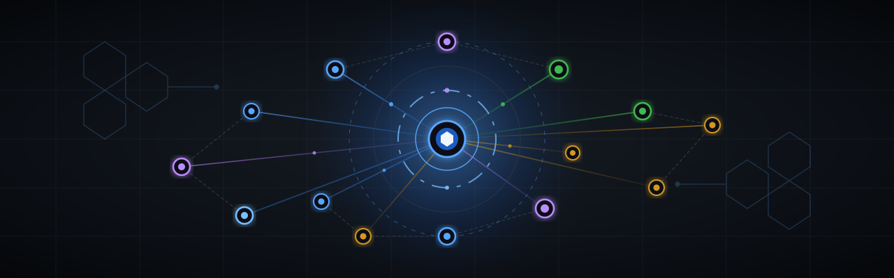
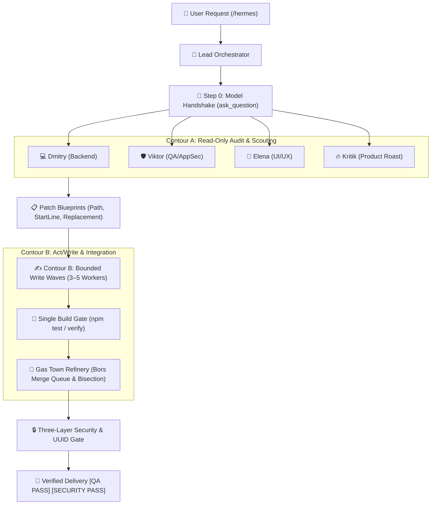
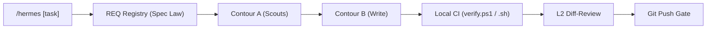

[English](README.md) | [Русский](README.ru.md)



# 🏛️ Hermes Fleet Enterprise for Google Antigravity (v4.0.0)

> A fleet of 14 autonomous AI specialists and 22 industrial skills for Google Antigravity that prevents coding agents from fixing 1 of 4 places, self-signing PRs, and hardcoding IPs.

[](plugin.json)
[](LICENSE)
[](.hermes/test-summary.json)
[](https://antigravity.google)
[](package.json)

---

## 🎯 The Problem → How Hermes Solves It

Coding assistants often stumble on complex production tasks: they perform partial edits, hallucinate passing tests, hardcode local environments, and cause cascading regressions. Hermes Fleet enforces a disciplined multi-agent engineering protocol.

| The Problem | How Hermes Solves It | Key Defense |
| :--- | :--- | :--- |
| 🔴 **Fixes 1 of 4 places:** The AI fixes a bug in one file, leaving 3 identical places broken across the codebase. | 🟢 **`REQ-1..REQ-N` Registry & N-of-N Sweep:** Tasks are broken into atomic Spec Law requirements; Viktor rejects partial fixes with `[QA REJECT]`. | [Rule 4 / Anti-Regression](skills/hermes/references/fleet-protocol.md#⚡-15-правил-hermes-collaboration-protocol) |
| 🔴 **Self-Signs `[QA PASS]`:** The agent hallucinates approval in its own prose without running tests. | 🟢 **Symmetric UUID Verdicts & `ackToken`:** Gates enforce authentic subagent delivery strictly from verified session UUIDs (`viktor`, `stanislav`, `kritik`). | [Rule 3 / Anti-Self-Signing](skills/hermes/references/fleet-protocol.md#⚡-15-правил-hermes-collaboration-protocol) |
| 🔴 **Hardcodes IPs & Secrets:** Raw IPs (`127.0.0.1`), dev ports, and credentials leak directly into committed code. | 🟢 **Rule 9 Zero-Hardcode PreToolUse Guard:** Intercepts and denies hardcoded paths, IPs, and secrets before execution with an audited escape hatch. | [Rule 9 / PreToolUse Guard](skills/hermes/references/fleet-protocol.md#⚡-15-правил-hermes-collaboration-protocol) |
| 🔴 **Breaks Neighboring Features:** Rapid AI edits introduce silent regressions and circular dependencies. | 🟢 **Regression Locks & Dual-Contour Pipeline:** Read-only scouts (Contour A) design blueprints; write waves (Contour B) merge via Bors-style Refinery queue. | [Rule 12 / Refinery Queue](skills/hermes/references/fleet-protocol.md#⚡-15-правил-hermes-collaboration-protocol) |

---

## ⚡ Quickstart in 30 Seconds

### 1. Installation

**Recommended (Cross-platform via Antigravity CLI):**
```bash
git clone https://github.com/neon1301/hermes-mode-antigravity.git
cd hermes-mode-antigravity
agy plugin install .
agy plugin validate . --strict
```

**Linux / macOS (Bash installer with automated hook configuration):**
```bash
git clone https://github.com/neon1301/hermes-mode-antigravity.git
cd hermes-mode-antigravity
chmod +x install.sh && ./install.sh
```

**Windows (PowerShell installer with automated hook configuration):**
```powershell
git clone https://github.com/neon1301/hermes-mode-antigravity.git
cd hermes-mode-antigravity
powershell -ExecutionPolicy Bypass -File .\install.ps1
```

### 2. Run Your First Task

In the Google Antigravity chat, start your prompt with `/hermes`:
```text
/hermes Build a resilient WebSocket telemetry client with reconnection backoff and zero memory allocations
```

---

## 🔄 How It Works

Hermes operates as a **Dual-Contour Multi-Agent Fleet**: the Lead Orchestrator coordinates specialized subagents across isolated read-only exploration and bounded write execution.

### Architectural Dual-Contour Pipeline



### Task Lifecycle Flow



---

## 💬 Interactive Demonstration

```text
User: /hermes Refactor machine telemetry parser to zero-alloc ReadOnlySpan<byte>

👑 Lead Orchestrator:
  - Step 0: Model Handshake locked (Gemini 3.8 Flash, Medium Tier)
  - REQ-1: Replace string splitting with Span<byte> slices in BinaryFrameParser.cs
  - REQ-2: Ensure 100% backward compatibility with framing test fixtures
  - REQ-3: N-of-N sweep across all 4 machine protocol drivers

🔍 Contour A (Read-Only Scout Dmitry @dmitry):
  - Generated Patch Blueprint for BinaryFrameParser.cs (lines 45–98)
  - Zero-alloc guarantee verified: 0 heap allocations per telemetry frame

✍️ Contour B (Lead Act/Write):
  - Applied Patch Blueprint via edit_file
  - Single Build Gate executed: 361/361 tests passed (3.4s)

🛡️ Verification Gate (UUID-bound deliveries):
  - @viktor: 🟢 [QA PASS] — Frame parser verified against all 4 drivers
  - @viktor: 🟢 [SECURITY PASS] — Buffer overflow and boundary checks passed
  - @stanislav: 🟢 [COMPLIANCE PASS] — 15 Rules of Hermes Fleet satisfied
```

<!-- SCREENSHOT_PLACEHOLDER: Add real Kanban UI screenshot here (run /hermes board in chat) -->
> 📷 *Tip: Run `/hermes board` in Antigravity chat to render the real-time Generative UI Kanban board.*

---

## 🎮 Command Reference

| Command | Purpose |
| :--- | :--- |
| **/hermes [task]** | Launch orchestrator, decompose goal into `REQ-1..REQ-N`, and coordinate specialists |
| **/hermes feature [description]** | 🚀 7-Phase feature development protocol (Discovery, 3 options, Fast-Path) |
| **/hermes board** | 📊 Display live interactive Kanban board in chat via Generative UI |
| **/hermes fix-warnings [--loop]** | 🧹 Batch eliminate compiler/linter warnings (Zero Warnings Policy; `--loop` enables convergence) |
| **/hermes loop [task]** | 🔄 Autonomous bounded convergence loop (ceiling of 25 iterations, L2 review at finale) |
| **/hermes audit** | ⚖️ Independent compliance audit of all 15 rules and 22 skills by Stanislav |
| **/hermes save / resume** | 💾 Snapshot sprint state to `.hermes/checkpoint.md` / Restore context from Memory Bank |
| **/hermes review** | 🛡️ Comprehensive code audit by Viktor across 7 vectors (`qa-test-automation` + `security-audit`) |
| **/hermes report** | 📊 Output session activity metrics, file edits, and gate decisions (Data Honesty) |
| **/hermes rules / standup** | 📜 Fleet declarative rules summary (`.hermes/rules/*.md`) / Team standup (`standups.md`) |
| **@name [query]** | Direct invocation of a specialist (`@dmitry`, `@elena`, `@viktor`, `@kritik`...) |

> 💡 **Zero-Context Activation:** Hermes activates only on explicit user triggers (`/hermes`, `@specialist`, or phrase «Hermes Mode»). Outside of active mode, hooks fail-open with zero token overhead.

---

## 👥 Specialist Roster & Skill Ecosystem

Hermes Fleet comprises **14 specialized agents** and **22 professional skills** designed as universal industrial and software engineers:

* 👑 **[Lead Orchestrator](skills/hermes/SKILL.md)** ([`hermes`](skills/hermes/SKILL.md)): Dual-contour governance, Spec Law, bounded write waves, and gate coordination.

<details>
<summary><b>🏗️ Architecture, Backend & Systems Engineering (Click to expand)</b></summary>

* **[💻 Dmitry](agents/dmitry.md)** ([`backend-architecture`](skills/backend-architecture/SKILL.md)): Clean & Hexagonal architecture, .NET/C#, Python/FastAPI, Go, Node.js, RFC 7807 APIs, Outbox, and zero-allocation performance.
* **[🧹 Sergey](agents/sergey.md)** ([`code-refactoring-modernization`](skills/code-refactoring-modernization/SKILL.md)): Safe decomposition of monoliths (>300–400 lines), CRAP-Score triage, Strangler Fig pattern, and zero patch scripts.
* **[📝 Anna](agents/anna.md)** ([`technical-documentation-adr`](skills/technical-documentation-adr/SKILL.md), [`c4-architecture-mermaid`](skills/c4-architecture-mermaid/SKILL.md)): Grounded technical writing, Diátaxis framework, Architecture Decision Records (ADRs), and executable Mermaid/C4 maps.
* **[🗄️ Denis](agents/denis.md)** ([`high-load-db-tuning`](skills/high-load-db-tuning/SKILL.md)): Multi-engine database architecture (SQLite WAL, PostgreSQL MVCC, MSSQL RCSI, MySQL/InnoDB, DuckDB), deadlock elimination, and pool hygiene.
</details>

<details>
<summary><b>🛡️ Quality Assurance, Security & Compliance (Click to expand)</b></summary>

* **[🛡️ Viktor](agents/viktor.md)** ([`qa-test-automation`](skills/qa-test-automation/SKILL.md), [`security-audit`](skills/security-audit/SKILL.md)): 7-vector review barrier, TDD Iron Law, Playwright/E2E, OWASP Top 10/ASVS, Cloudflare Fresh-Verifier, and Trail of Bits diff audits (`[QA PASS]`, `[SECURITY PASS]`).
* **[⚖️ Stanislav](agents/stanislav.md)** ([`compliance-policy-as-code`](skills/compliance-policy-as-code/SKILL.md), [`cognitive-discipline`](skills/cognitive-discipline/SKILL.md)): Independent fleet auditor, Policy as Code, 15 rules enforcement, contract arbitration, and cognitive sobriety checklist (`[COMPLIANCE PASS]`).
</details>

<details>
<summary><b>🎨 Frontend, 3D Digital Twins & Product Experience (Click to expand)</b></summary>

* **[🎨 Elena](agents/elena.md)** ([`frontend-design`](skills/frontend-design/SKILL.md)): Bespoke design systems (Anthropic Frontend Design), Web & Desktop GUI (WinForms/WPF), 4-state contracts, and WCAG 2.2 AA accessibility.
* **[🌐 Gleb](agents/gleb.md)** ([`procedural-3d-digital-twin`](skills/procedural-3d-digital-twin/SKILL.md)): Procedural 3D modeling (Three.js/WebGL), factory floor digital twins (T01–T20), telemetry animation, and zero VRAM leaks.
* **[🔥 Kritik](agents/kritik.md)** ([`product-ux-scouting`](skills/product-ux-scouting/SKILL.md)): 360° product critic, global tech forum scouting (RU/CN/BE/EU/JP/US), Nielsen 0–4 UX roast, and killer-feature evaluation (`[UX PASS]`).
</details>

<details>
<summary><b>🏭 Industrial Hardware, PLC & Enterprise Systems (Click to expand)</b></summary>

* **[⚙️ Alexey](agents/alexey.md)** ([`industrial-equipment-research`](skills/industrial-equipment-research/SKILL.md), [`socket-network-diagnostics`](skills/socket-network-diagnostics/SKILL.md)): Universal machinery research, PLCs, sensors, register maps, Modbus, Profinet, EtherCAT, and socket stream resilience (`CA2022`).
* **[🏭 Igor](agents/igor.md)** ([`hardware-protocol-simulation`](skills/hardware-protocol-simulation/SKILL.md)): Stateful FSM mock servers, multi-vendor telemetry emulators, packet fuzzing, and deterministic fault injection (`--seed`).
* **[📊 Ruslan](agents/ruslan.md)** ([`sap-enterprise-automation`](skills/sap-enterprise-automation/SKILL.md), [`office-documents`](skills/office-documents/SKILL.md)): Enterprise SAP integration (NCo 3.0/3.1.x, BAPI, GUI Scripting, IDoc, OData) and formula-first Excel/Word automation.
* **[🔍 Artem](agents/artem.md)** ([`reverse-engineer-anything`](skills/reverse-engineer-anything/SKILL.md)): Reverse engineering (REA), binary frame disassembly, .NET/CIL and Electron/ASAR decompilation, and Evidence Ledger.
</details>

<details>
<summary><b>🧠 AI Systems, RAG & Context Memory Engineering (Click to expand)</b></summary>

* **[🧠 Mikhail](agents/mikhail.md)** ([`ai-rag-engineering`](skills/ai-rag-engineering/SKILL.md), [`agent-context-memory-engineering`](skills/agent-context-memory-engineering/SKILL.md), [`llm-finetuning-multimodal-ops`](skills/llm-finetuning-multimodal-ops/SKILL.md)): Hybrid RAG, HNSW vector indexes, context compaction, long-term memory architectures, LLM Red-Teaming, and LoRA/vLLM ops.
</details>

---

## 🗺️ Engineering Roadmap

Real tasks tracked in [`docs/backlog.md`](docs/backlog.md) and `.hermes/tasks.json`:

- **[TASK-004] (P1, v4.0.1):** Narrow `hermes-hardcode-ignore` scope to the exact violation line (±1 line) and formalize schema compatibility shim in [ADR 0001](docs/adr/0001-l2-diff-review-and-anti-self-signing.md).
- **[TASK-005] (P2, v4.0.1):** Verify subagent UUID FIFO assignment resilience in multi-invoke steps and bind via `tool_call_id`.
- **[TASK-006] (P3, Post-v4.0.1):** Dynamic Convoy stall & distributed deadlock detection hook for multi-agent swarms.

---

## 🔒 Local CI & Pre-Push Verification

Hermes Fleet includes a **Zero-Billing Local CI Gate**:

```bash
# Run all 11 test suites locally (361 tests)
npm test

# Windows PowerShell Local CI
powershell -ExecutionPolicy Bypass -File .\verify.ps1

# Linux / macOS / Git Bash Local CI
./verify.sh
```

Pre-push hook is active via `.githooks/pre-push` (`git config core.hooksPath .githooks`). Every push is verified locally before reaching remote branches.

---

## 📜 Legal, Attribution & Support

- **License:** [MIT License](LICENSE)
- **Attribution & Open Source Notices:** [THIRD_PARTY_NOTICES.md](THIRD_PARTY_NOTICES.md) (Apache-2.0 donor mechanics)
- **Troubleshooting Guide:** [TROUBLESHOOTING.md](TROUBLESHOOTING.md)
- **Release History:** [CHANGELOG.md](CHANGELOG.md)
