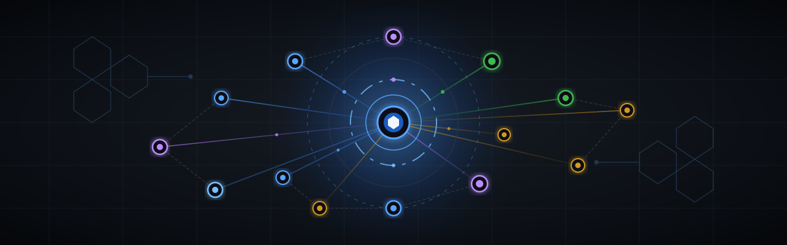
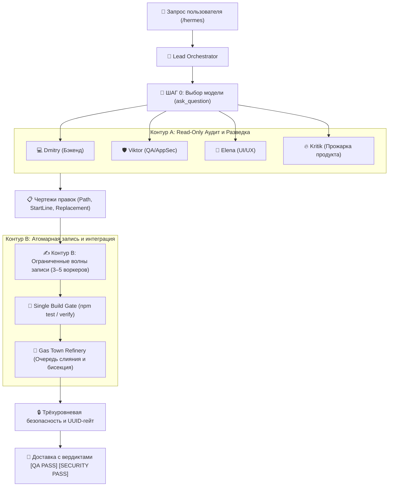
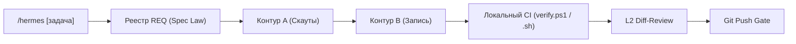

[English](README.md) | [Русский](README.ru.md)



# 🏛️ Hermes Fleet Enterprise для Google Antigravity (v4.7.2)

> Команда из 14 автономных ИИ-специалистов и 22 промышленных скиллов для Google Antigravity, которая не даёт агенту чинить 1 из 4 мест, самоподписываться и хардкодить.

[](plugin.json)
[](LICENSE)
[](.hermes/test-summary.json)
[](https://antigravity.google)
[](package.json)

---

## 🎯 Проблема → Как Hermes решает её

Обычные ИИ-ассистенты часто оступаются на сложных промышленных задачах: применяют частичные правки, галлюцинируют успешными тестами, хардкодят локальное окружение и порождают каскадные регрессии. Мультиагентный комплекс Hermes задаёт жёсткую инженерную дисциплину.

| Проблема | Как Hermes решает её | Ключевая защита |
| :--- | :--- | :--- |
| 🔴 **Чинит 1 из 4 мест:** ИИ исправляет ошибку в одном файле, оставляя скрытые баги в остальных 3 однотипных местах кодовой базы. | 🟢 **Реестр `REQ-1..REQ-N` и сквозной поиск N из N:** Задачи декомпозируются по Spec Law; Viktor блокирует частичные правки с `[QA REJECT]`. | [Правило 4 / Anti-Regression](skills/hermes/references/fleet-protocol.md#⚡-15-правил-hermes-collaboration-protocol) |
| 🔴 **Сам себе пишет `[QA PASS]`:** Агент выдумывает одобрение в своей прозе без реального запуска сборки и тестов. | 🟢 **Симметричная привязка по UUID и `ackToken`:** Вердикты принимаются строго из системных доставок проверенных UUID субагентов (`viktor`, `stanislav`, `kritik`). | [Правило 3 / Anti-Self-Signing](skills/hermes/references/fleet-protocol.md#⚡-15-правил-hermes-collaboration-protocol) |
| 🔴 **Хардкодит IP и секреты:** В коммиты утекают `127.0.0.1`, локальные порты, абсолютные пути и незащищённые пароли. | 🟢 **Правило 9 Zero-Hardcode PreToolUse Guard:** Автоматически перехватывает и блокирует хардкод до записи с сохранением аудируемого escape hatch. | [Правило 9 / PreToolUse Guard](skills/hermes/references/fleet-protocol.md#⚡-15-правил-hermes-collaboration-protocol) |
| 🔴 **Ломает соседние модули:** Бесконтрольные правки порождают тихие регрессии и спагетти-код. | 🟢 **Регрессионные замки и двухконтурный пайплайн:** Read-only разведка (Контур A) выдаёт чертежи; волны записи (Контур B) сливаются через Refinery merge queue. | [Правило 12 / Refinery Queue](skills/hermes/references/fleet-protocol.md#⚡-15-правил-hermes-collaboration-protocol) |
| 🔴 **Копит тихий долг и заглушки:** Снаружи программа работает и тесты зелены, а внутри копятся мёртвый код, пустые `catch`, stub-заглушки и забытые таймеры. | 🟢 **Механический Рентген и Книга долга:** Двухпроходный pure-stdlib сканер раскладывает находки по корзинам с проверкой ссылок (zero-ref proof) и ведёт `.hermes/debt-ledger.jsonl`. | [Протокол Рентгена](skills/hermes/references/xray-protocol.md) |

---

## ⚡ Быстрый старт за 30 секунд

### 1. Установка

**Рекомендуемый способ (кроссплатформенно через Antigravity CLI):**
```bash
git clone https://github.com/neon1301/hermes-mode-antigravity.git
cd hermes-mode-antigravity
agy plugin install .
agy plugin validate . --strict
```

**Linux / macOS (Bash-инсталлятор с автонастройкой хуков):**
```bash
git clone https://github.com/neon1301/hermes-mode-antigravity.git
cd hermes-mode-antigravity
chmod +x install.sh && ./install.sh
```

**Инсталлятор для Windows (PowerShell с автонастройкой хуков):**
```powershell
git clone https://github.com/neon1301/hermes-mode-antigravity.git
cd hermes-mode-antigravity
powershell -ExecutionPolicy Bypass -File .\install.ps1
```

### 2. Запуск первой задачи

В чате Google Antigravity начните запрос с команды `/hermes`:
```text
/hermes Разработай отказоустойчивый WebSocket-клиент телеметрии станков с экспоненциальным backoff и zero memory allocations
```

---

## 🔄 Как это работает

Hermes работает как **двухконтурный мультиагентный флот**: Lead Orchestrator координирует узкопрофильных специалистов через изоляцию контекста, отделяя безопасную разведку от пакетной записи.

### Архитектурный двухконтурный пайплайн



### Жизненный цикл задачи



---

## 💬 Интерактивная демонстрация работы

```text
Пользователь: /hermes Переведи парсер телеметрии станков на zero-alloc ReadOnlySpan<byte>

👑 Lead Orchestrator:
  - ШАГ 0: Модель зафиксирована (Gemini 3.8 Flash, Medium Tier)
  - REQ-1: Замена string.Split на срезы Span<byte> в BinaryFrameParser.cs
  - REQ-2: 100% обратная совместимость со всеми тестовыми фикстурами кадров
  - REQ-3: Сквозной аудит N из N по всем 4 драйверам промышленного оборудования

🔍 Контур A (Read-Only скаут Dmitry @dmitry):
  - Сформирован Patch Blueprint для BinaryFrameParser.cs (строки 45–98)
  - Подтверждена нулевая аллокация в куче (0 bytes allocations per frame)

✍️ Контур B (Правка Lead Act/Write):
  - Применён Patch Blueprint через edit_file
  - Выполнен Single Build Gate: [Пример] 410/410 тестов прошли (3.4 с)

🛡️ Гейт верификации (UUID-привязанные вердикты):
  - @viktor: 🟢 [QA PASS] — Парсер кадров проверен на всех 4 промышленных протоколах
  - @viktor: 🟢 [SECURITY PASS] — Проверены границы буферов и защита от переполнения
  - @stanislav: 🟢 [COMPLIANCE PASS] — 15 Правил флота Hermes соблюдены
```

<!-- SCREENSHOT_PLACEHOLDER: Add real Kanban UI screenshot here (run /hermes board in chat) -->
> 📷 *Совет: Введите `/hermes board` в чате Antigravity, чтобы открыть живую интерактивную Канбан-доску на Generative UI.*

---

## 🩺 Механический Рентген и Книга долга (v4.7.2)

Зелёные тесты сами по себе не гарантируют чистоты кода: снаружи программа работает, а внутри остаётся мусор, нереализованные заглушки, пустые блоки `catch` и хрупкие костыли с таймерами. Пользователь этого не видит и не может сформулировать в промпте. **Рентген Hermes** находит такие дефекты САМ, выводит простой человечный дайджест из $\le 5$ пунктов и ведёт книгу технического долга без блокировки разработки.

### 1. Три корзины классификации
* 🗑️ **Мёртвый код (`dead`) — Доказанный мусор:** Функции, переменные и несмонтированные обработчики с доказанным отсутствием вызовов (0 ссылок по всему репозиторию).
* 🚧 **Недоделки (`stub`) — Риск сбоя:** Заглушки (`throw new NotImplementedException()`, `return null;`, `return {};`), пустые `catch`-блоки, проглатывающие исключения, и брошенные метки `TODO`/`FIXME`.
* 🩹 **Костыли (`fragile`) — Хрупкие подпорки:** Подавление линтеров (`@ts-ignore`, `eslint-disable`), синхронизация через `setTimeout`/`Thread.Sleep`, захардкоженные лимиты повторов и отсутствие обработки ошибок.

### 2. Классификация по влиянию на пользователя (User Impact)
Каждая находка оценивается по реальной эксплуатационной опасности, а не по теоретическому пуризму:
* 💥 `brick_risk`: Необработанное исключение или забытый обработчик, способный аварийно завершить процесс.
* 🛑 `lies_to_user`: Интерфейс или API рапортует об успехе, но под капотом возвращает фиктивные или пустые данные.
* ⏳ `resource_waste`: Забытый таймер, утекающий подписчик или незакрытый поток, пожирающий память и сокеты.
* 🎨 `cosmetic`: Не влияющий на работу дефект форматирования, устаревший комментарий или стилистический недочёт.

### 3. Человечное окно ревью и 3 кнопки выбора
В финале спринта Рентген показывает ненавязчивое окно из $\le 5$ ключевых находок простым русским языком (ноль внутренних кодов ошибок, ноль процентов) с 3 стандартными кнопками:
1. **`[Почини сейчас]`**: Переводит задачу в Plan Gate `PLAN_REVISED` v(N+1) с выделенной рубрикой исправления.
2. **`[Запиши в долг]`**: Сохраняет находку в файл `.hermes/debt-ledger.jsonl`. В следующих задачах до 3 приоритетных долгов ($\le 1024$ байт) автоматически внедряются в контекст агента через `context-injector.mjs`.
3. **`[Не трогай]`**: Помечает пункт как `accepted` (осознанный технический долг) и исключает повторные напоминания.

### 4. Защита от самодеятельности и Advisory-контракт
* **Доказательство отсутствия ссылок (`xray_delete_without_zero_ref_proof_deny`):** Агенту категорически запрещено удалять подозреваемый мёртвый код без строгого подтверждения отсутствия внешних и внутренних вызовов (`refs: 0`).
* **Advisory Fail-Open конвейер:** Рентген работает на ветке `allow` хука Stop. Он советует и ведёт учёт, но **никогда** не запирает пайплайн и не блокирует сборку.
* **21 защищённый путь:** Файлы `.hermes/xray-report.json` и `.hermes/debt-ledger.jsonl` защищены от несанкционированной модификации агентом наряду с остальными журналами вердиктов.
* **Честные границы:** Pure stdlib сканер поддерживает JavaScript, TypeScript, ES5, HTML, CSS и типовые текстовые форматы. Разбор графа символов Roslyn для C#/XAML вынесен в [TASK-020]; оценка блокирующего режима (`enforce`) — в [TASK-021].

### 5. Результаты собачьего корма (Dogfooding) [Пример]
Прогон сканера по кодовой базе самого комплекса Hermes Fleet (224 файла, время < 400 мс):
* **По категориям:** 0 dead, 93 stub, 164 fragile (суммарно 257 находок).
* **По влиянию:** 0 `lies_to_user`, 93 `brick_risk`, 1 `resource_waste`, 163 `cosmetic`.
*(Примечание: метрики догфудинга приведены как реальный эмпирический пример, а не как гарантия).*

Подробные спецификации и JSON-схемы описаны в документе [Протокол Рентгена](skills/hermes/references/xray-protocol.md).

---

## 🎮 Справочник команд

| Команда | Назначение |
| :--- | :--- |
| **/hermes [задача]** | Запуск оркестратора, декомпозиция цели в `REQ-1..REQ-N` и координация экспертов |
| **/hermes feature [описание]** | 🚀 7-фазный протокол проектирования фич (Discovery, 3 альтернативы, Fast-Path) |
| **/hermes council [задача]** | 🏛️ Обязательный совет профильных специалистов до проектирования ([`specialist-council-protocol.md`](skills/hermes/references/specialist-council-protocol.md)) |
| **/hermes board** | 📊 Вывод интерактивной Канбан-доски прямо в чат через Generative UI |
| **/hermes xray [--all]** | 🩺 Механический поиск мёртвого кода, заглушек и хрупких костылей в проекте |
| **/hermes fix-warnings [--loop]** | 🧹 Устранение предупреждений компилятора до нуля (Zero Warnings Policy; `--loop` включает сходимость) |
| **/hermes loop [задача]** | 🔄 Автономный ограниченный цикл сходимости (потолок 25 итераций, L2 в финале) |
| **/hermes audit** | ⚖️ Независимая ревизия соблюдения всех 15 правил флота и 22 скиллов силами Stanislav |
| **/hermes save / resume** | 💾 Мгновенный снимок спринта в `.hermes/checkpoint.md` / Восстановление из Memory Bank |
| **/hermes review** | 🛡️ Комплексный аудит кода силами Viktor по 7 векторам (`qa-test-automation` + `security-audit`) |
| **/hermes report** | 📊 Отчёт об активности сессии, правках файлов и решениях гейта (Data Honesty) |
| **/hermes rules / standup** | 📜 Сводка декларативных правил (`.hermes/rules/*.md`) / Стендап команды (`standups.md`) |
| **@имя [запрос]** | Прямой адресный вызов специалиста (`@dmitry`, `@elena`, `@viktor`, `@kritik`...) |

### Переносимый запуск CLI (для любого репозитория)
Запуск Рентгена и выгрузка логов напрямую из установленного плагина для любого внешнего проекта:

**PowerShell (Windows):**
```powershell
# Запуск сканера Рентгена для целевого репозитория
node "$HOME\.gemini\config\plugins\hermes-fleet\scripts\xray-scan.mjs" --workspace="."

# Выгрузка неизменяемых артефактов прогона и книги долга
node "$HOME\.gemini\config\plugins\hermes-fleet\scripts\export-logs.mjs" --workspace="."
```

**Bash (Linux / macOS):**
```bash
# Запуск сканера Рентгена для целевого репозитория
node "$HOME/.gemini/config/plugins/hermes-fleet/scripts/xray-scan.mjs" --workspace="."

# Выгрузка неизменяемых артефактов прогона и книги долга
node "$HOME/.gemini/config/plugins/hermes-fleet/scripts/export-logs.mjs" --workspace="."
```

> 💡 **Zero-Context активация:** Hermes включается только по явному запросу (`/hermes`, `@специалист` или фраза «режим Hermes»). Вне режима хуки работают fail-open с нулевым оверхедом по токенам.

---

## 👥 Штат специалистов и каталог скиллов

Флот Hermes объединяет **14 узкопрофильных агентов** и **22 профессиональных скилла**, спроектированных для промышленного и корпоративного ПО:

* 👑 **[Lead Orchestrator](skills/hermes/SKILL.md)** ([`hermes`](skills/hermes/SKILL.md)): Двухконтурное управление, Spec Law, ограниченные волны записи и координация гейтов приёмки.

<details>
<summary><b>🏗️ Архитектура, бэкенд и системная инженерия (Нажмите, чтобы развернуть)</b></summary>

* **[💻 Dmitry](agents/dmitry.md)** ([`backend-architecture`](skills/backend-architecture/SKILL.md)): Чистая архитектура, .NET/C#, Python/FastAPI, Go, Node.js, RFC 7807 API, Outbox и zero-alloc перформанс.
* **[🧹 Sergey](agents/sergey.md)** ([`code-refactoring-modernization`](skills/code-refactoring-modernization/SKILL.md)): Безопасный распил монолитов (>300–400 строк), CRAP-Score селекция, Strangler Fig и нулевые патч-скрипты.
* **[📝 Anna](agents/anna.md)** ([`technical-documentation-adr`](skills/technical-documentation-adr/SKILL.md), [`c4-architecture-mermaid`](skills/c4-architecture-mermaid/SKILL.md)): Честная техническая документация, система Diátaxis, архитектурные решения (ADR) и исполняемые схемы Mermaid/C4.
* **[🗄️ Denis](agents/denis.md)** ([`high-load-db-tuning`](skills/high-load-db-tuning/SKILL.md)): Промышленная архитектура БД (SQLite WAL, PostgreSQL MVCC, MSSQL RCSI, MySQL/InnoDB, DuckDB), устранение дедлоков и гигиена пулов.
</details>

<details>
<summary><b>🛡️ Контроль качества, безопасность и комплаенс (Нажмите, чтобы развернуть)</b></summary>

* **[🛡️ Viktor](agents/viktor.md)** ([`qa-test-automation`](skills/qa-test-automation/SKILL.md), [`security-audit`](skills/security-audit/SKILL.md)): 7-векторный барьер приёмки, TDD Iron Law, Playwright/E2E, OWASP Top 10/ASVS, Cloudflare Fresh-Verifier и дифференциальный аудит кода (`[QA PASS]`, `[SECURITY PASS]`).
* **[⚖️ Stanislav](agents/stanislav.md)** ([`compliance-policy-as-code`](skills/compliance-policy-as-code/SKILL.md), [`cognitive-discipline`](skills/cognitive-discipline/SKILL.md)): Независимый аудитор флота, Policy as Code, контроль 15 правил, арбитраж контрактов и чеклист когнитивной дисциплины (`[COMPLIANCE PASS]`).
</details>

<details>
<summary><b>🎨 Фронтенд, 3D цифровые двойники и UX продукта (Нажмите, чтобы развернуть)</b></summary>

* **[🎨 Elena](agents/elena.md)** ([`frontend-design`](skills/frontend-design/SKILL.md)): Авторские дизайн-системы (Anthropic Frontend Design), Web и Desktop GUI (WinForms/WPF), контракт 4 состояний и стандарты доступности WCAG 2.2 AA.
* **[🌐 Gleb](agents/gleb.md)** ([`procedural-3d-digital-twin`](skills/procedural-3d-digital-twin/SKILL.md)): Процедурное 3D-моделирование (Three.js/WebGL), цифровые двойники цеха (T01–T20), анимация телеметрии и нулевые утечки VRAM.
* **[🔥 Kritik](agents/kritik.md)** ([`product-ux-scouting`](skills/product-ux-scouting/SKILL.md)): 360° продуктовый критик, скаут мировых форумов (RU/CN/BE/EU/JP/US), прожарка окон по Нильсену 0–4 и оценка киллер-фич (`[UX PASS]`).
</details>

<details>
<summary><b>🏭 Промышленное оборудование, PLC и Enterprise-интеграция (Нажмите, чтобы развернуть)</b></summary>

* **[⚙️ Alexey](agents/alexey.md)** ([`industrial-equipment-research`](skills/industrial-equipment-research/SKILL.md), [`socket-network-diagnostics`](skills/socket-network-diagnostics/SKILL.md)): Исследование станков, PLC, датчиков, карты регистров, Modbus, Profinet, EtherCAT и надёжность сокетов (`CA2022`).
* **[🏭 Igor](agents/igor.md)** ([`hardware-protocol-simulation`](skills/hardware-protocol-simulation/SKILL.md)): Stateful FSM эмуляторы станков, многовендорные симуляторы телеметрии, фаззинг пакетов и детерминированная инжекция сбоев (`--seed`).
* **[📊 Ruslan](agents/ruslan.md)** ([`sap-enterprise-automation`](skills/sap-enterprise-automation/SKILL.md), [`office-documents`](skills/office-documents/SKILL.md)): Корпоративная интеграция с SAP (NCo 3.0/3.1.x, BAPI, GUI Scripting, IDoc, OData) и формульная автоматизация Excel/Word.
* **[🔍 Artem](agents/artem.md)** ([`reverse-engineer-anything`](skills/reverse-engineer-anything/SKILL.md)): Реверс-инжиниринг (REA), дизассемблирование бинарных фреймов, декомпиляция .NET/CIL и Electron/ASAR, ведение Evidence Ledger.
</details>

<details>
<summary><b>🧠 ИИ-системы, RAG и инженерия контекстной памяти (Нажмите, чтобы развернуть)</b></summary>

* **[🧠 Mikhail](agents/mikhail.md)** ([`ai-rag-engineering`](skills/ai-rag-engineering/SKILL.md), [`agent-context-memory-engineering`](skills/agent-context-memory-engineering/SKILL.md), [`llm-finetuning-multimodal-ops`](skills/llm-finetuning-multimodal-ops/SKILL.md)): Гибридный RAG, векторные индексы HNSW, компрессия контекста, долговременная память агентов, LLM Red-Teaming и LoRA/vLLM пайплайны.
</details>

---

## 🗺️ Дорожная карта инженерии (Roadmap)

Реальные задачи из [`docs/backlog.md`](docs/backlog.md) и `.hermes/tasks.json` (поведенческий eval-набор в [`docs/evals/README.md`](docs/evals/README.md)):

- **[TASK-006] (P3, Post-v4.7.2):** Хук динамического обнаружения тупиков (Convoy stall) и распределённых взаимных блокировок в графе задач.
- **[TASK-020] (P2, Post-v4.7.2):** Выделенный адаптер C# / XAML для сканера «Рентген» (граф символов Roslyn/MSBuild).
- **[TASK-021] (P3, Post-v4.7.2):** Оценка опционального блокирующего режима `xray: "enforce"` после эмпирической телеметрии ложных срабатываний.
- **[TASK-022] (P2, Post-v4.7.2):** Маскирование ссылок документацией/эвалами (инцидент `collectWrittenText`) и разделение рантайм- и пассивных ссылок.
- **[TASK-023] (P2, Post-v4.7.2):** Механическая запись `.hermes/security-verdict.json` при верификации хуком Stop.
- **[TASK-024] (P2, Post-v4.7.2):** Обновление устаревшего `.hermes/council-state.json` в продолженных чатах без повторного вызова `/hermes`.
- **[TASK-025] (P2, Post-v4.7.2):** Механическая проверка релизного тега (`verify-before-claim`) и правило в уроках.

---

## 🔒 Локальный CI и pre-push защита

В Hermes встроен **автономный локальный CI-гейт (Zero Billing Dependency)**, покрывающий 619 тестов в 11 сьютах:

| Набор тестов (Suite) | Тесты | Статус | Область проверки |
| :--- | :---: | :---: | :--- |
| `clean-edits-guard` | 313 | 🟢 PASS | PreToolUse защита от хардкода, совет специалистов, целостность плана и zero-ref замки |
| `qa-gate` | 128 | 🟢 PASS | Проверка Stop-хука, верификация UUID субагентов и гейт единой сборки |
| `eval-harness` | 71 | 🟢 PASS | Поведенческие сценарии, тесты устойчивости и регрессионный контроль |
| `consistency` | 23 | 🟢 PASS | Целостность ссылок, 21 защищённый путь, матрицы синхронизации и запрет A2A |
| `context-injector` | 20 | 🟢 PASS | Инжекция пользовательских промптов, лимиты памяти и интеграция книги долга |
| `rule-engine` | 20 | 🟢 PASS | Соблюдение Spec Law, 15 правил флота и синтаксический аудит правил |
| `doc-lint` | 15 | 🟢 PASS | Валидация разметки Markdown, структуры ADR и фронтматтера |
| `contract-validator` | 9 | 🟢 PASS | Схемы JSON-контрактов и валидация межмодульных интерфейсов |
| `refinery` | 9 | 🟢 PASS | Очереди слияния волн записи двухконтурного пайплайна |
| `session-report` | 6 | 🟢 PASS | Метрики сессии, учёт токенов и итоговые сводки активности |
| `journal` | 5 | 🟢 PASS | Журнал прогресса append-only и восстановление контекста |
| **Итого** | **619** | **🟢 PASS** | **100% покрытие локальным верификатором** |

```bash
# Запуск всех 11 тестовых сьютов локально (619 тестов)
npm test

# Windows PowerShell Local CI
powershell -ExecutionPolicy Bypass -File .\verify.ps1

# Linux / macOS / Git Bash Local CI
./verify.sh
```

Pre-push хук активен через `.githooks/pre-push` (`git config core.hooksPath .githooks`). Любой `git push` проходит автоматическую локальную проверку перед отправкой на удалённый сервер.

---

## 📜 Лицензия, атрибуция и поддержка

- **Лицензия:** [MIT License](LICENSE)
- **Уведомления об открытом коде и атрибуция:** [THIRD_PARTY_NOTICES.md](THIRD_PARTY_NOTICES.md) (механики доноров Apache-2.0)
- **Руководство по устранению неполадок:** [TROUBLESHOOTING.md](TROUBLESHOOTING.md)
- **Известные границы (протокол vs механика):** [docs/known-boundaries.md](docs/known-boundaries.md)
- **История версий:** [CHANGELOG.md](CHANGELOG.md)
