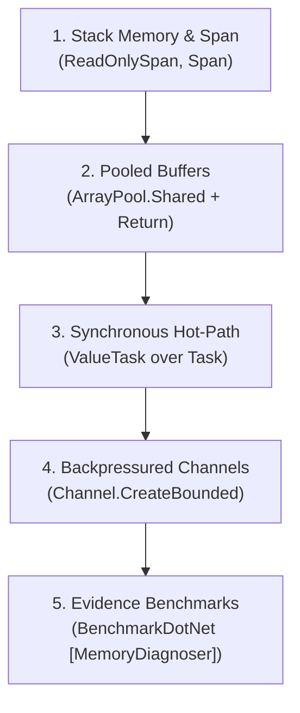

# 🚀 C# Zero-Allocation & High-Performance Engineering (.NET 10 / C# 14)

Production-grade performance engineering reference for **Dmitry (`@dmitry`)** and **Viktor (`@viktor`)** to eliminate heap allocations, eliminate GC pauses, and maximize throughput in telemetry, socket, and backend pipelines.

---

## 🏛️ The 5 Pillars of Zero-Allocation C#



---

## 1. ⚡ Stack Memory & Zero-Copy Span Parsing

Never use `string.Split()`, `Substring()`, or byte copying in high-throughput hot paths. Always slice via `ReadOnlySpan<T>`:

```csharp
using System;
using System.Buffers.Text;

public static class FastTelemetryParser
{
    // Zero-allocation: parses "SPEED:1420;RPM:3800\n" directly from raw byte buffer
    public static bool TryParseMetrics(ReadOnlySpan<byte> buffer, out int speed, out int rpm)
    {
        speed = 0;
        rpm = 0;

        // Search delimiter without string allocation
        int semiIdx = buffer.IndexOf((byte)';');
        if (semiIdx == -1) return false;

        ReadOnlySpan<byte> speedPart = buffer.Slice(0, semiIdx);
        ReadOnlySpan<byte> rpmPart = buffer.Slice(semiIdx + 1);

        // Fast Utf8 parsing without string decoding
        int colon1 = speedPart.IndexOf((byte)':');
        if (colon1 != -1 && Utf8Parser.TryParse(speedPart.Slice(colon1 + 1), out int parsedSpeed, out _))
        {
            speed = parsedSpeed;
        }

        int colon2 = rpmPart.IndexOf((byte)':');
        if (colon2 != -1 && Utf8Parser.TryParse(rpmPart.Slice(colon2 + 1), out int parsedRpm, out _))
        {
            rpm = parsedRpm;
        }

        return true;
    }
}
```

---

## 2. 🏊 ArrayPool Buffer Hygiene

Allocating `new byte[4096]` per socket frame triggers Gen0 / LOH garbage collection churn. Rent from `ArrayPool<byte>.Shared`:

```csharp
using System.Buffers;

public static async ValueTask ProcessSocketStreamAsync(Stream stream, CancellationToken ct)
{
    byte[] rentedBuffer = ArrayPool<byte>.Shared.Rent(8192);
    try
    {
        while (!ct.IsCancellationRequested)
        {
            int bytesRead = await stream.ReadAsync(rentedBuffer.AsMemory(0, 8192), ct);
            if (bytesRead == 0) break;

            // Process sliced span - 0 bytes heap allocated
            ProcessFrame(rentedBuffer.AsSpan(0, bytesRead));
        }
    }
    finally
    {
        // Mandatory: Always return to pool in finally block
        ArrayPool<byte>.Shared.Return(rentedBuffer, clearArray: false);
    }
}

private static void ProcessFrame(ReadOnlySpan<byte> frame) { /* Logic */ }
```

---

## 3. 🎯 ValueTask for Synchronously Available Results

When data is already buffered or cached in memory, returning `Task<T>` allocates an object in the heap. Use `ValueTask<T>`:

```csharp
public readonly struct CachedTokenLookup
{
    private readonly Memory<byte> _cachedToken;
    private readonly bool _hasCache;

    public ValueTask<ReadOnlyMemory<byte>> GetTokenAsync(CancellationToken ct)
    {
        // Hot-path: Zero allocation when result is already in memory
        if (_hasCache)
        {
            return new ValueTask<ReadOnlyMemory<byte>>(_cachedToken);
        }

        // Cold-path: Asynchronous remote fetch allocates Task only when truly async
        return new ValueTask<ReadOnlyMemory<byte>>(FetchTokenRemoteAsync(ct));
    }

    private async Task<ReadOnlyMemory<byte>> FetchTokenRemoteAsync(CancellationToken ct)
    {
        await Task.Delay(10, ct);
        return Memory<byte>.Empty;
    }
}
```

---

## 4. 🚰 Non-Blocking Backpressure Channels

Never use unbounded queues or naked `ConcurrentQueue<T>` without drop policies for high-volume message streaming:

```csharp
using System.Threading.Channels;

public static class TelemetryChannelFactory
{
    public static Channel<TelemetryEvent> CreateProductionChannel(int capacity = 10000)
    {
        var options = new BoundedChannelOptions(capacity)
        {
            FullMode = BoundedChannelFullMode.Wait, // Applies backpressure: slow producers wait
            SingleReader = true,                   // JIT optimization for single consumer loop
            SingleWriter = false,
            AllowSynchronousContinuations = false  // Prevents deadlocks / sync-over-async
        };

        return Channel.CreateBounded<TelemetryEvent>(options);
    }
}
```

---

## 5. 📊 BenchmarkDotNet Evidence Verification

Prove performance improvements with empirical evidence:

```csharp
using BenchmarkDotNet.Attributes;
using BenchmarkDotNet.Running;

[MemoryDiagnoser] // Measures allocated bytes per operation
public class StringVsSpanBenchmark
{
    private static readonly byte[] RawData = "DEVICE:Loom01;RPM:3850;YARN_BREAK:0\n"u8.ToArray();

    [Benchmark(Baseline = true)]
    public (string, int) ClassicStringSplit()
    {
        string text = System.Text.Encoding.UTF8.GetString(RawData);
        string[] parts = text.Split(';');
        int rpm = int.Parse(parts[1].Split(':')[1]);
        return (parts[0], rpm); // Allocates strings and string arrays
    }

    [Benchmark]
    public (bool, int) ZeroAllocSpanParser()
    {
        // 0 B Allocated, 5-10x faster execution
        bool ok = FastTelemetryParser.TryParseMetrics(RawData, out int speed, out int rpm);
        return (ok, rpm);
    }
}
```

---

## 📋 Dmitry's Zero-Alloc Quality Checklist
- [ ] **No `string.Split()` in Hot Loops:** Replaced with `ReadOnlySpan<char>` or `MemoryExtensions.Split()`.
- [ ] **ArrayPool Hygiene:** All rented arrays returned inside `finally` blocks.
- [ ] **ValueTask on Hot-Paths:** Functions returning synchronous cached values use `ValueTask<T>`.
- [ ] **Bounded Channels:** All worker queues bounded with explicit `BoundedChannelFullMode`.
- [ ] **Zero Memory Leak:** Zero static event subscriptions holding short-lived objects.
