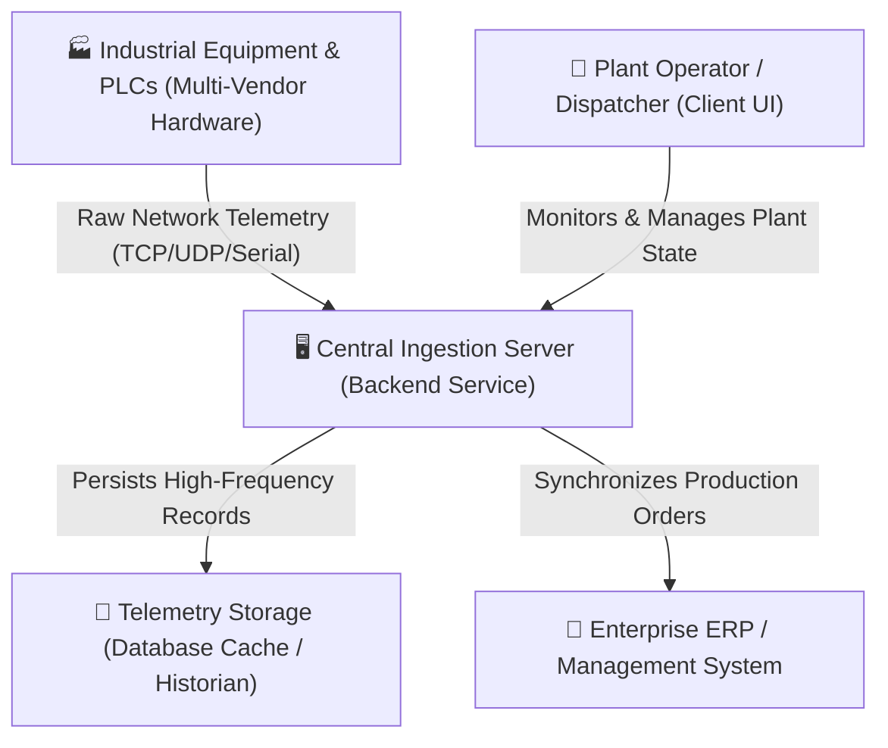
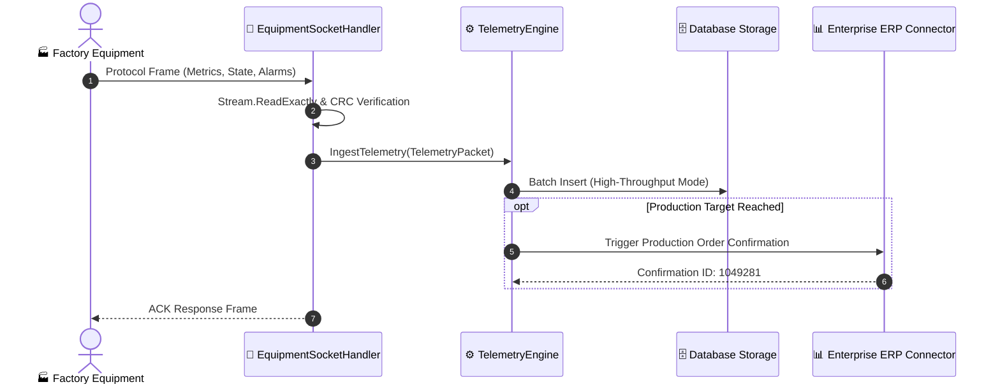

# C4 Architecture & Mermaid Diagramming Skill

This skill guides technical architects (primarily **📝 Anna**) in translating complex, sprawling codebases into clear, hierarchical architectural models using the **C4 Model** and **Mermaid.js**.

---

## 1. The 4 Levels of the C4 Model

```text
[Level 1: System Context] ──> Big picture: People, external enterprise systems (SAP), factory machines
            │
            ▼
[Level 2: Container]      ──> Executable units: WinForms App, Windows Service, SQLite, MSSQL
            │
            ▼
[Level 3: Component]      ──> Internal building blocks: SocketServer, TelemetryPipeline, SapConnector
            │
            ▼
[Level 4: Code]           ──> Class diagrams, state machines, and sequence handshakes
```

---

## 2. Mermaid Diagram Templates

### Level 1: System Context Diagram


---

### Level 2 & 3: Container / Component Sequence Diagram


---

## 3. Best Practices & Rules
- **Escape Special Characters:** Always quote node labels containing brackets, colons, or parentheses (e.g. `Server["Ingestion Server (v2.0)"]`).
- **Use Semantic Icons:** Pair emojis with labels to make large diagrams immediately legible to factory operators and engineers.
- **Save to `.hermes/docs/`:** Store generated diagrams alongside Markdown documentation for permanent project retention.
