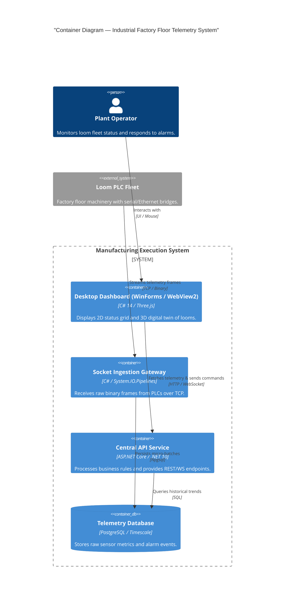
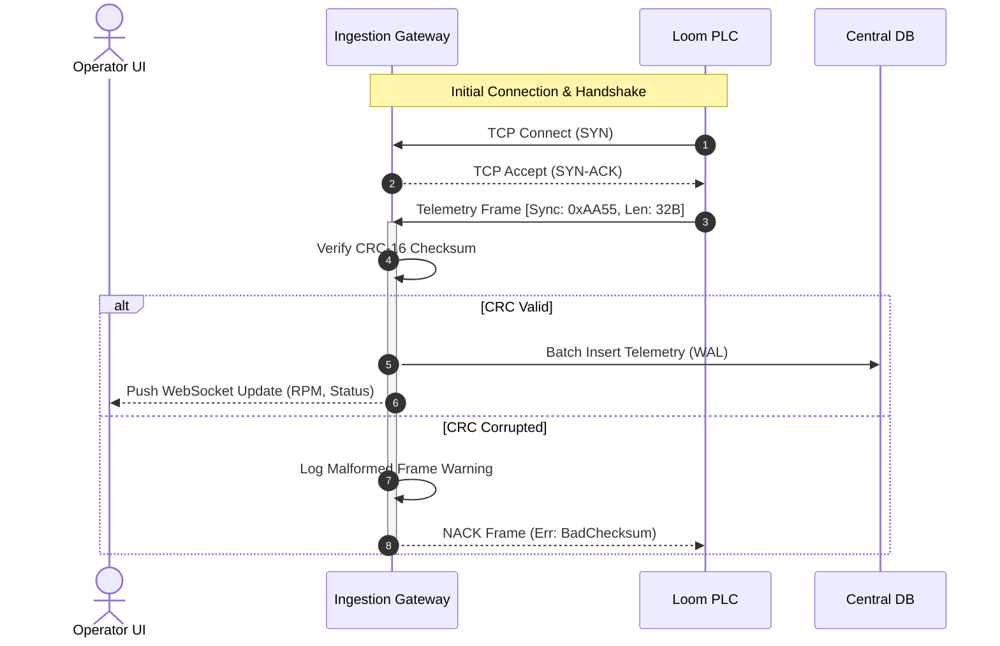

# Living C4 Architecture Diagrams, Protocol Sequence Flows & ADR Governance

This reference manual provides production-grade architectural documentation patterns for **📝 Anna** (Principal Technical Writer & Docs Architect) covering living Mermaid C4 models, dynamic protocol sequence diagrams, and ADR lifecycle governance.

---

## 1. Living C4 Container & Component Diagrams (Mermaid)

C4 diagrams must reflect the actual runtime codebase. To prevent rendering syntax errors in markdown viewers, **all node labels containing special characters, brackets, or commas MUST be double-quoted**. Never embed raw HTML tags (` `, `
`) in Mermaid nodes.

### Container-Level Example (Industrial Factory Telemetry System)

---

## 2. Dynamic Industrial Protocol Sequence Diagrams

Sequence diagrams document packet flow, timeouts, and error handling across distributed components:

---

## 3. Living OpenAPI / Contract Synchronization

To prevent documentation rot, technical documentation must be generated from or validated against code contracts:
1. **Source of Truth:** C# DTO records and Controller endpoints define the wire schema.
2. **RFC 7807 Problem Details:** Document error responses using standard RFC 7807 format (`type`, `title`, `status`, `detail`, `instance`).
3. **No Phantom Endpoints:** Every endpoint listed in OpenAPI docs must have a corresponding test in `@viktor`'s test suite.

---

## 4. ADR (Architecture Decision Record) Lifecycle

Format all architectural decisions as lightweight, version-controlled records:
- **Title:** `ADR-NNNN: [Short imperative summary]`
- **Status:** `Proposed` | `Accepted` | `Deprecated` | `Superseded by ADR-XXXX`
- **Context:** The technical driver, constraints, and problem statement.
- **Decision:** The chosen architecture or technology and why alternatives were rejected.
- **Consequences:** Positive benefits, trade-offs, and operational liabilities.
