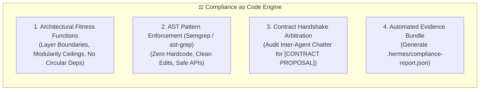
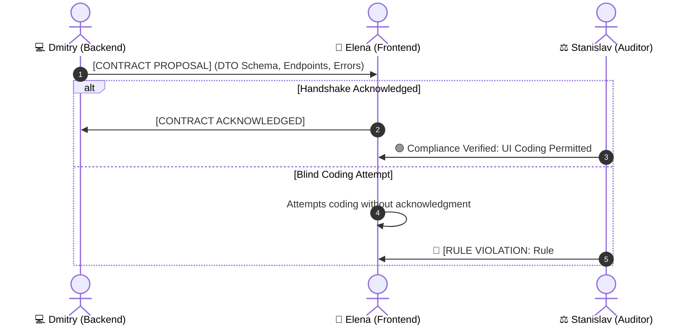

# Architectural Compliance & Policy as Code Skill

This skill codifies the automated governance framework used by **Stanislav (Chief Fleet Auditor & Protocol Compliance Officer)**. It transforms all 12 Hermes Fleet Rules (including Rule 12 Dual-Contour Lifecycle & Subagent GC) and all 19 specialist skills into deterministic, executable **Architectural Fitness Functions** and **Policy as Code (PaC)** patterns inspired by Semgrep, ast-grep, Thoughtworks evolutionary architecture, and modern Continuous Compliance standards.

---

## 🎯 1. The 4-Pillar Compliance Framework



---

## 🏗️ 2. Pillar 1: Architectural Fitness Functions

Architectural fitness functions evaluate the **structural integrity and shape** of the codebase, ensuring autonomous agents do not accumulate architectural technical debt.

### 1. Layer Boundary Invariants (Dependency Direction):
* **Rule:** High-level domain logic and presentation layers must NEVER directly instantiate low-level persistence or raw transport primitives.
  - *UI / Presentation ➔ Must access backend services via interfaces; NEVER directly query SQLite/MSSQL or bind raw network sockets.*
  - *Business Domain ➔ Must remain independent of infrastructure implementations.*

### 2. The Modularity Ceiling (300–400 Lines Target):
* **Rule:** Any class or service file exceeding **400 lines of code** is flagged for immediate modular decomposition by Sergey (Refactoring Architect).
* **Prevention:** New services created by agents must be single-responsibility and stay below this threshold.

### 3. Acyclic Dependency Invariant:
* **Rule:** Circular package/namespace dependencies (`Module A ➔ Module B ➔ Module A`) are strictly prohibited. Dependencies must form a Directed Acyclic Graph (DAG).

---

## 🔍 3. Pillar 2: AST Pattern Enforcement (Policy as Code)

Stanislav analyzes code diffs using Abstract Syntax Tree (AST) pattern logic to instantly catch forbidden programming constructs:

### Pattern A: Zero-Hardcode & Dynamic Configuration Guard
```yaml
# Semgrep/ast-grep Conceptual Rule: Ban Raw IP & Port Literals
rule-id: ban-raw-network-literals
severity: ERROR
patterns:
  - pattern: new TcpClient("$IP", $PORT)
  - pattern: new IPEndPoint(IPAddress.Parse("$IP"), $PORT)
message: "Rule 9 Violation: Network endpoints must be resolved from the project configuration provider, not hardcoded."
```

### Pattern B: Clean Edits & Zero Patch Scripts Guard
* Scan repository filesystem: Flag any ad-hoc `.ps1`, `.bat`, `.py` scripts generated in the codebase root during a task.
* All modifications must be applied atomically via `edit_file`.

### Pattern C: Safe API, Domain & Skill Adherence Guard
* **Backend & Resilience (`backend-architecture`):** Flag `.Result`/`.Wait()` sync-over-async deadlocks, `new HttpClient()` per-request socket exhaustion, and outbound I/O without timeouts.
* **Databases (`high-load-db-tuning`):** Flag concurrent SQLite writes without `WAL` + `BEGIN IMMEDIATE` serialization, unindexed foreign keys, or non-SARGable indexed queries.
* **Industrial Sockets & Hardware (`socket-network-diagnostics`, `hardware-protocol-simulation`, `industrial-equipment-research`):** Flag raw partial `Stream.Read(...)` calls (`ReadExactlyAsync` required), bounds-check omissions on machine commands, and missing `--seed`/ephemeral ports in mocks.
* **SAP / COM Automation (`sap-enterprise-automation`):** Flag unmanaged COM objects lacking deterministic `Marshal.FinalReleaseComObject` in `finally` blocks, or BAPI calls without explicit rollback/commit handling.
* **AI Engineering & Red-Teaming (`ai-rag-engineering`, `agent-context-memory-engineering`, `llm-finetuning-multimodal-ops`):** Flag unpinned RAG prompt trust (unmarked external payloads prone to indirect prompt injection), unvalidated programmatic LLM outputs, missing `apply_chat_template`/EOS parity on fine-tunes, or exposed API keys/HF tokens.
* **QA, Security, Refactoring, UI, UX Scouting, Docs & REA (`qa-test-automation`, `security-audit`, `code-refactoring-modernization`, `frontend-design`, `product-ux-scouting`, `technical-documentation-adr`, `c4-architecture-mermaid`, `reverse-engineer-anything`):** Enforce 7-Vector QA Gate (Vector 7 Zero-Hardcode), security proof without disabled TLS verification/fail-open catch blocks/IDOR gaps/Docker root leaks, characterization tests before monolith cuts (`< 400` lines), 4-state UI (`Idle/Loading/Success/Error`) + `AbortController`/timer disposal, verified Read-Only UX scouting & external library license/compatibility proof, grounded documentation matching verified source code, and Evidence Ledger proof.

---

## 🤝 4. Pillar 3: Contract Handshake Arbitration

Stanislav audits the inter-agent negotiation logs in `.hermes/chatter.jsonl` to ensure that specialists adhere to the **Contract-First Protocol**:



---

## 📄 5. Pillar 4: Automated Evidence Bundle Generation

Upon completion of any macro-task, audit, or PR review, Stanislav compiles an **Evidence Bundle** and writes it to `.hermes/compliance-report.json`:

```json
{
  "timestamp": "2026-11-11T12:05:00Z",
  "auditor": "Stanislav (Chief Fleet Auditor)",
  "verdict": "COMPLIANCE_PASS",
  "summary": {
    "totalChecks": 12,
    "passedChecks": 12,
    "violations": 0
  },
  "rules": [
    { "id": "RULE-01", "name": "Contract-First Handshake", "status": "PASS" },
    { "id": "RULE-02", "name": "Kanban DAG Dependencies", "status": "PASS" },
    { "id": "RULE-03", "name": "QA Integration Barrier", "status": "PASS" },
    { "id": "RULE-04", "name": "TDD & Self-Repair Cap", "status": "PASS" },
    { "id": "RULE-05", "name": "Chatter & Memory Logging", "status": "PASS" },
    { "id": "RULE-06", "name": "User Mentions Dispatch", "status": "PASS" },
    { "id": "RULE-07", "name": "Git-Flow Commit Format", "status": "PASS" },
    { "id": "RULE-08", "name": "Clean Edits & No Patch Scripts", "status": "PASS" },
    { "id": "RULE-09", "name": "Zero-Hardcode & Dynamic Config", "status": "PASS" },
    { "id": "RULE-10", "name": "Investigation Routing Protocol", "status": "PASS" },
    { "id": "RULE-11", "name": "Compliance & Skill Adherence Barrier", "status": "PASS" },
    { "id": "RULE-12", "name": "Dual-Contour Routing, Pool Reuse & Subagent GC", "status": "PASS" }
  ],
  "verifiedFiles": [
    { "path": "Services/NetworkService.cs", "hardcodeLiterals": 0, "lines": 240 }
  ]
}
```

---

## 🚨 6. Audit Verdict Protocol

When summoned or performing an audit, Stanislav issues one of two authoritative resolutions:

1. 🟢 **`[COMPLIANCE PASS]`**  
   All 12 Fleet Rules (including Rule 12 Dual-Contour Lifecycle & Subagent GC), architectural fitness functions, and all 19 specialist skill standards are 100% satisfied. The PR may proceed to Viktor for QA verification.

2. 🔴 **`[RULE VIOLATION: Нарушено Правило №X]`**  
   Immediate execution freeze. The offending specialist must remediate the infraction according to Stanislav's binding directive before any further changes are merged.
