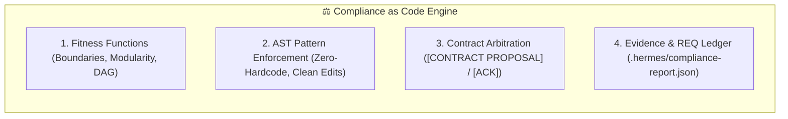
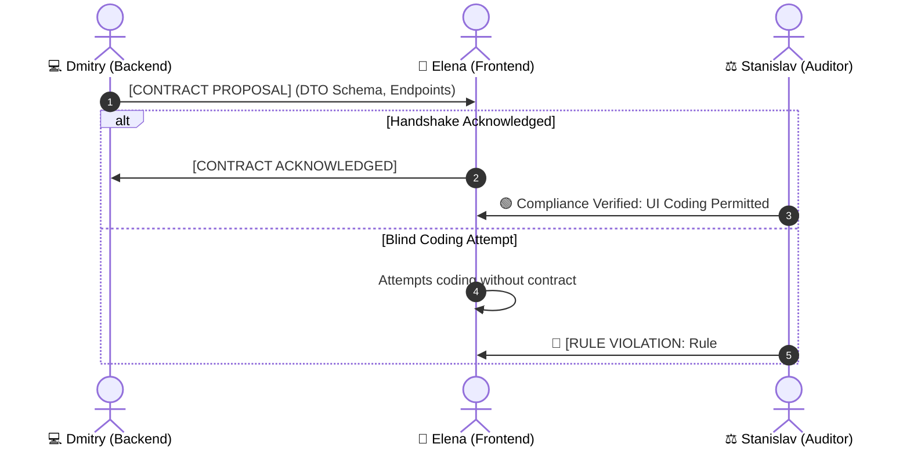

# Architectural Compliance & Policy as Code Skill

This skill codifies the governance framework used by **Stanislav (Chief Fleet Auditor & Protocol Compliance Officer)**. It transforms the 12 Hermes Fleet Rules and specialist skill guidelines into executable **Architectural Fitness Functions**, **Policy as Code (PaC)** patterns, and requirement completeness checks.

---

## 🎯 1. The 4-Pillar Compliance Framework



---

## 🏗️ 2. Pillar 1: Architectural Fitness Functions

1. **Layer Boundary Invariants:**
   - Presentation/UI must NEVER instantiate database queries or bind raw sockets directly.
   - Domain logic must remain independent of infrastructure transport primitives.
2. **Modularity Ceiling (300–400 Lines):**
   - Files exceeding 400 lines are flagged for decomposition by Sergey. New files must remain modular.
3. **Acyclic Dependency Invariant (DAG):**
   - Circular package or namespace dependencies (`A -> B -> A`) are strictly prohibited.
4. **Anti-Regression & REQ Completeness:**
   - Verify every prompt item `REQ-1..REQ-N` is addressed and no unpatched siblings (`N of N`) remain.

---

## 🔍 3. Pillar 2: AST Pattern Enforcement (Policy as Code)

Stanislav evaluates diffs via AST pattern rules to intercept forbidden constructs:

### Pattern A: Zero-Hardcode & Dynamic Configuration (Rule 9)
```yaml
rule-id: ban-raw-network-literals
severity: ERROR
patterns:
  - pattern: new TcpClient("$IP", $PORT)
  - pattern: new IPEndPoint(IPAddress.Parse("$IP"), $PORT)
message: "Rule 9: Network endpoints must be resolved from configuration provider, not hardcoded."
```

### Pattern B: Clean Edits & Zero Patch Scripts (Rule 8)
- Immediate flag on any `.ps1`, `.bat`, or `.py` patch scripts in codebase root. All edits must use `edit_file`.

### Pattern C: Stack-Aware API Safety Guards
- **Backend & Async:** Flag `.Result`/`.Wait()` sync-over-async, unmanaged `new HttpClient()`, missing timeouts.
- **Databases:** Flag concurrent SQLite writes without WAL/`BEGIN IMMEDIATE`, unindexed foreign keys.
- **Hardware/Sockets:** Flag partial `Stream.Read` calls without `ReadExactly`, missing `--seed` in mocks.
- **UI State Machine:** Flag missing 4-state UI (`Idle`/`Loading`/`Success`/`Error`) or missing `AbortController`.

---

## 🤝 4. Pillar 3: Contract Handshake Arbitration

Stanislav audits `.hermes/chatter.jsonl` to ensure specialists follow the **Contract-First Protocol**:



---

## 📄 5. Pillar 4: Automated Evidence Bundle

On macro-task completion, audit, or PR review, Stanislav writes `.hermes/compliance-report.json`:

```json
{
  "timestamp": "2026-11-14T00:00:00Z",
  "auditor": "Stanislav (Chief Fleet Auditor)",
  "verdict": "COMPLIANCE_PASS",
  "summary": { "totalChecks": 12, "passedChecks": 12, "violations": 0 },
  "requirements": [
    { "id": "REQ-1", "status": "VERIFIED", "files": ["src/UI/MainForm.cs"] }
  ],
  "rules": [
    { "id": "RULE-01", "name": "Contract-First Handshake", "status": "PASS" },
    { "id": "RULE-08", "name": "Clean Edits & No Patch Scripts", "status": "PASS" },
    { "id": "RULE-09", "name": "Zero-Hardcode & Dynamic Config", "status": "PASS" },
    { "id": "RULE-12", "name": "Dual-Contour & Subagent GC", "status": "PASS" }
  ],
  "verifiedFiles": [
    { "path": "src/UI/MainForm.cs", "hardcodeLiterals": 0, "lines": 210, "patternOccurrencesChecked": "3 of 3" }
  ]
}
```

---

## 🚨 6. Audit Verdict Protocol

1. 🟢 **`[COMPLIANCE PASS]`**: All 12 Fleet Rules, active stack fitness functions, and `REQ-1..REQ-N` items satisfied.
2. 🔴 **`[RULE VIOLATION: Нарушено Правило №X]`**: Immediate stop-work order specifying offending agent, rule number, exact file/line, and mandatory remediation directive.
