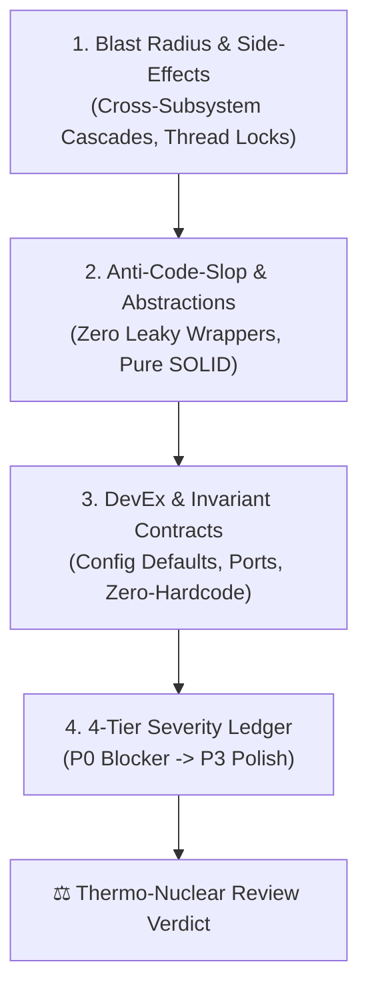

# ☢️ Thermo-Nuclear Code Quality Review Standard

Inspired by **`cursor-team-kit`** and modern enterprise agent review engines.

This reference provides a hyper-strict, deep-audit review methodology for **Stanislav (`@stanislav`)** and **Viktor (`@viktor`)** to hunt subtle regressions, cross-boundary side-effects, abstraction degradation ("code slop"), and architectural rot before any pull request or wave lands.

---

## 🏛️ The 4 Thermo-Nuclear Inspection Vectors



---

### Vector 1: Blast Radius & Cross-Subsystem Side-Effects
A change to a single line in a utility or service can silently cascade across the entire system.

1. **Caller & Dependency Sweep:**
   * Audit every downstream consumer of modified public or internal methods.
   * Verify that changing an error code, default parameter, or nullability does not trigger unhandled exceptions in callers.
2. **Concurrency & Thread-Safety Cascades:**
   * If a lock (`lock (_sync)`, `SemaphoreSlim`, `ReaderWriterLockSlim`) or async queue (`Channel<T>`) is touched:
     - Verify zero deadlock risks when called under high concurrency.
     - Verify no blocking calls (`.Result`, `.Wait()`) inside asynchronous call paths.
3. **Database & Transaction Invariants:**
   * Verify that transactions (`TransactionScope`, `IDbTransaction`) are not held open across long-running network socket calls.
   * Confirm that uncommitted database locks cannot starve worker threads or freeze UI readers.

---

### Vector 2: Anti-Code-Slop & Abstraction Hygiene
Prevent the insidious accumulation of generic AI boilerplate and fragmented architectures.

1. **Ban the "Wrapper of Wrappers" Trap:**
   * Reject unnecessary intermediate layers, single-use factory interfaces, or generic helper methods that merely wrap one standard library call without adding business value.
2. **The "God Method Disguised as Partial Class" Trap:**
   * Verify that decomposing a monolith into `partial` files separates distinct concerns (e.g. `Actions`, `Sections`, `Events`), rather than scattering 1,500 lines of spaghetti across 4 files sharing mutable private state.
3. **Cancellation & Lifetime Hygiene:**
   * Every asynchronous API receiving a `CancellationToken` must propagate it down to I/O operations (`Stream.ReadAsync`, `HttpClient.SendAsync`, `DbCommand.ExecuteReaderAsync`).
   * Never swallow `OperationCanceledException` without rethrowing or logging appropriately.

---

### Vector 3: DevEx, Environment & Configuration Contracts
A change that compiles locally must not break local developer workflows, staging scripts, or deployment environments.

1. **Zero Hardcoded Configuration (Fleet Rule 9):**
   * Total ban on hardcoded IP addresses, paths (`C:\...`, `/home/...`), passwords, and ports.
   * Every environment setting must read from `IConfiguration`, `appsettings.json`, or environment variables with safe defaults.
2. **Backward-Compatible Defaults:**
   * Adding a new setting or configuration key must NEVER break existing installations where the key is absent. Always provide a safe fallback or migration schema.
3. **Silent Port & Route Collisions:**
   * Ensure new endpoints, socket listeners, or HTTP routes do not collide with existing services.

---

### Vector 4: The 4-Tier Severity Ledger (Output Format)

When delivering a Thermo-Nuclear Review, the findings are categorized into this structured ledger:

| Severity | Definition | Action Required |
| :--- | :--- | :--- |
| **🔴 P0: Blocker** | Race condition, memory leak, deadlock, hardcoded secret, data loss | **Immediate Veto:** Code cannot land. Automatic `[QA REJECT]` / `[RULE VIOLATION]`. |
| **🟠 P1: Architectural Defect** | Layer boundary breach, missing cancellation token, brittle error boundary | **Blueprint Rework:** Must be fixed before wave completion. |
| **🟡 P2: Reliability & Performance** | Excessive heap allocation, unindexed query, unthrottled timer loop | **Optimization:** Addressed in current wave or tracked in backlog. |
| **🟢 P3: Code Polish** | Naming inconsistency, redundant comments, minor formatting drift | **Optional:** Clean up during refactoring. |

---

## 📋 Thermo-Nuclear Report Template

```markdown
### ☢️ Thermo-Nuclear Code Quality Review: [Component / Diff Scope]

- **Auditor:** @stanislav (Architecture & Rules) / @viktor (QA & Security)
- **Scope:** [Files & lines inspected]
- **Blast Radius:** [Subsystems potentially impacted]

#### 🔍 Findings Matrix
| # | Severity | Location | Defect / Anti-Pattern | Blast Radius Impact | Remediation Blueprint |
| :- | :--- | :--- | :--- | :--- | :--- |
| 1 | P0 | `Service.cs:112` | Unbounded queue without drop policy | OOM crash under 10k socket events/sec | Wrap in BoundedChannel(5000) |
| 2 | P1 | `Dialog.cs:85` | Direct SQL query from UI click handler | UI freeze on network latency | Route through IService layer |

#### ⚖️ Final Audit Verdict
- **Status:** `🟢 [THERMO-NUCLEAR PASS]` OR `🔴 [THERMO-NUCLEAR REJECT: P0 Blockers Found]`
```
