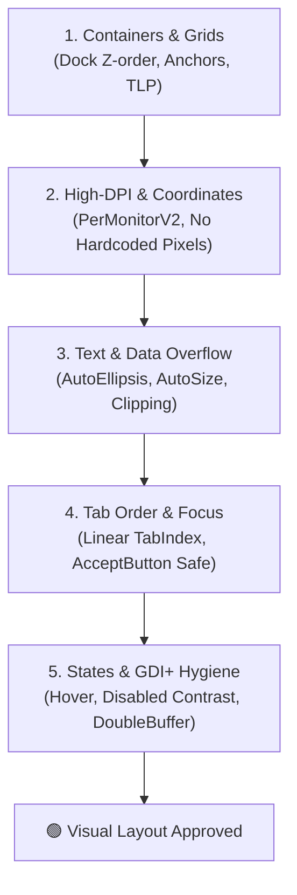

# 🎨 Visual QA & Layout Audit Guide (Elena's Defect Hunter)

Inspired by **`mistyhox/frontend-design-audit`**, **`jakubkrehel/skills`** (`better-layout`, `better-interface`), **`pixeljury`**, and **Microsoft High-DPI Desktop Standards**.

This reference provides a systematic, 5-phase diagnostic protocol for **Elena (`@elena`)** to detect, diagnose, and remediate visual defects, broken layouts, coordinate collisions, and UI state traps across Desktop (.NET WinForms / WPF) and Web (React / HTML / CSS) interfaces.

---

## 🔍 The 5 Diagnostic Vectors of UI "Кривизна" (Visual Defect Audit)



---

### Vector 1: Container Hierarchy, Dock Z-Order & Anchor Traps

Desktop forms and complex web grids frequently suffer from overlapping containers, crushed controls, and z-order clobbering.

1. **The Dock.Fill Z-Order Invariant:**
   * *The Defect:* In Windows Forms, docked controls are evaluated in reverse order of addition in the `Controls` collection. If a control with `Dock = DockStyle.Fill` is added before adjacent `Top`, `Bottom`, `Left`, or `Right` docked panels, it overlaps them, stealing clicks or hiding borders.
   * *The Rule:* **Controls docked to `Fill` must ALWAYS be added last** (at the bottom of the designer/initialization list) or brought to back (`SendToBack()` / `BringToFront()` audit).
2. **Conflicting Anchors & Container Crushing:**
   * *The Defect:* Assigning opposing anchors (e.g. `Anchor = Top | Bottom | Left | Right`) directly to complex controls without a bounding container causes controls to crush into 0-pixel heights or clip labels when the form is shrunk.
   * *The Rule:* Never anchor opposite sides unless wrapping the control in an explicit container `Panel` with `MinimumSize` defined to prevent collapse.
3. **TableLayoutPanel (TLP) Cell Collisions:**
   * *The Defect:* Hardcoded absolute pixel widths (`SizeType.Absolute`) in TLP columns push sibling columns off-screen when DPI or font size increases.
   * *The Rule:* Prefer `SizeType.Percent` or `SizeType.AutoSize` for content cells. Check that `Margin` on child controls does not trigger unintended horizontal scrollbars inside cells.
4. **Dock & Anchor Mixing:**
   * *The Rule:* Never mix `Dock` and `Anchor` on the same control. If inside a docked panel, use margins and docking or isolated anchoring.

---

### Vector 2: High-DPI Scaling & Coordinate Hygiene (PerMonitorV2)

Modern multi-monitor setups (100% 96 DPI desktop + 150%/200% 4K laptop) reveal severe coordinate drift and layout fragmentation.

1. **Zero Hardcoded Pixel Constants:**
   * *The Defect:* Setting manual coordinates in code-behind (e.g. `control.Left = 180`, `control.Size = new Size(600, 400)`). At 150% scaling, 180px is too narrow, causing controls to overlap.
   * *The Rule:* Layout adjustments must rely on containers (`FlowLayoutPanel`, `TableLayoutPanel`, `Panel.Padding`) or scale explicitly using `LogicalToDeviceUnits()` / `DpiHelper`.
2. **AutoScaleMode Consistency:**
   * *The Defect:* A parent Form has `AutoScaleMode = AutoScaleMode.Dpi`, while nested `UserControl` instances use `AutoScaleMode.Font` (or `None`). This creates compounding scaling mismatches.
   * *The Rule:* Ensure uniform `AutoScaleMode` across the entire visual tree.
3. **Anchor Creep / Rounding Drift:**
   * *The Defect:* Moving forms between displays or repeated resize passes causes bottom/right-anchored controls to drift inward by 1–2 pixels per pass due to integer rounding errors.
   * *The Fix:* Wrap problematic control clusters inside a root container `Panel` with `DockStyle.Fill`.

---

### Vector 3: Text Truncation, Dynamic Data Bounds & Clipping

Interfaces that look fine with static placeholder text break immediately when exposed to real-world strings, translations, or extreme lists.

1. **Label Text Clipping Trap:**
   * *The Defect:* Labels with `AutoSize = false` and a fixed `Size` truncate longer localized text or dynamic server names.
   * *The Rule:* Use `AutoSize = true` with `MaximumSize` constrained, or set `AutoEllipsis = true` with a descriptive `ToolTip`.
2. **Descender Clipping:**
   * *The Defect:* Font descenders (`g`, `y`, `p`, `щ`, `д`) get cut off at the bottom border of buttons, tabs, or badges because line-height or cell height was sized without font metrics padding.
   * *The Rule:* Add at least 2–4px bottom padding/margin on text-bearing elements. Check `UseCompatibleTextRendering = false` for clean GDI+ text rendering.
3. **Extreme Data Bounds:**
   * *Empty State:* What happens when the list/table has 0 items? Must show an informative empty state with an active action CTA, not a broken void or blank grey rectangle.
   * *Extreme State:* What happens with 10,000 items? Verify virtual mode (`VirtualMode = true` in `DataGridView`, `ListViewItemSorter` efficiency).
4. **Network Paths & Identifiers:**
   * *The Rule:* Long SMB paths (`\\server\share\very\long\path\...`), IP endpoints, or hashes must never force horizontal scrolling on parent windows. Truncate with middle ellipsis (`\\server\...\path`) and show full string on hover.

---

### Vector 4: Keyboard Navigation, Focus Traversal & Form Discipline

1. **Linear TabIndex Order:**
   * *The Defect:* Pressing `Tab` jumps randomly between tabs, buttons, and inputs because controls were added haphazardly in the designer.
   * *The Rule:* Tab order must follow natural visual reading flow (top-to-left ➔ bottom-to-right). Group related fields into containers with sequential `TabIndex`.
2. **AcceptButton & CancelButton Safety:**
   * *The Defect:* Binding form's `AcceptButton` to a "Save" or "OK" button while the form contains multiline textboxes or search inputs. Pressing `Enter` accidentally submits or closes the dialog without saving.
   * *The Rule:* In multi-tab configuration dialogs, do NOT bind `AcceptButton` to the primary action if child inputs handle `Enter`. Provide explicit, deliberate button clicks or hotkeys.
3. **Mnemonics & Accelerators:**
   * *The Rule:* Primary buttons and navigation tabs should feature distinct mnemonics (`&Save`, `&Cancel`, `&Browse`) with zero duplicate shortcut collisions on the same form.
4. **Keyboard Focus Indicator:**
   * *The Rule:* When navigating via keyboard (`Tab` / Arrows), the focused element must display a distinct visual cue (accent border, focus ring). Never suppress focus cues in custom `OwnerDraw` controls.

---

### Vector 5: Interactive States, GDI+ Resource Safety & Anti-Flicker

1. **4-State Visual Feedback Contract:**
   Every clickable element (button, tree node, tab, toggle, list item) must implement 4 visually distinct states:
   * **`Default / Idle`:** Clean contrast, neutral theme background.
   * **`Hover`:** Subtle highlight (`ServerTheme.BackgroundHover`, `Cursors.Hand`), never sudden layout shifts.
   * **`Pressed / Active`:** Clear indented or accent fill indicating selection.
   * **`Disabled`:** Readable muted text (> 3:1 contrast ratio against background). Never render dark grey text on dark black background!
2. **Anti-Flicker Rendering Discipline:**
   * Set `DoubleBuffered = true` on custom controls.
   * In custom controls handling `OnPaint`, enable:
     ```csharp
     SetStyle(ControlStyles.OptimizedDoubleBuffer |
              ControlStyles.AllPaintingInWmPaint |
              ControlStyles.UserPaint, true);
     ```
   * Wrap batch control modifications inside `SuspendLayout()` and `ResumeLayout()`.
3. **GDI+ Resource Leak Guard:**
   * Any `Font`, `SolidBrush`, `Pen`, or `Bitmap` created dynamically inside `OnPaint` or render loops MUST be disposed or cached as static/readonly. Leaking GDI handles causes the infamous "red cross" (GDI crash) after extended usage.

---

## 📋 Elena's Visual Defect Blueprint (Output Format)

When auditing or reviewing UI code, Elena reports visual and layout defects using this structured ledger:

```markdown
### 🎨 Visual & Layout Audit: [Component / Dialog Name]

| # | Vector | Location | Defect Description | Visual Impact | Recommended Fix |
| :- | :--- | :--- | :--- | :--- | :--- |
| 1 | V1: Containers | `Dialog.Designer.cs:142` | Dock.Fill added before Dock.Top | Fill panel overlaps header buttons | Move Fill control to bottom of Controls.Add list |
| 2 | V2: High-DPI | `Control.cs:88` | Hardcoded `new Size(320, 24)` | Input field truncated at 150% scaling | Replace with TableLayoutPanel column AutoSize |
| 3 | V4: Focus | `Dialog.cs:54` | AcceptButton bound to btnSave | Pressing Enter in search box closes dialog | Detach AcceptButton from form level |
```
