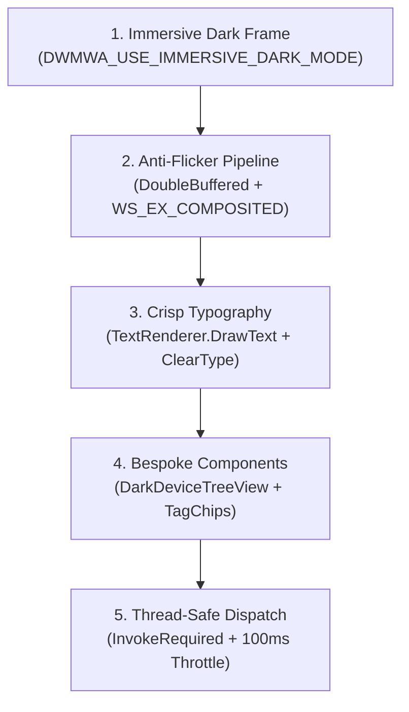

# 🎨 Modern WinForms & Dark Controls Engineering (.NET 10 / C# 14)

Production-grade engineering manual for **Elena (`@elena`)** and **Критик (`@kritik`)** to craft bespoke, high-performance, dark-themed Windows Forms interfaces without flicker, blurry text, or GDI leaks.

---

## 🏛️ Core Architectural Pillars



---

## 1. 🪟 Immersive Dark Frame (Win32 DWM Interop)

Standard WinForms forms in dark themes retain blinding white title bars. Fix this via modern Desktop Window Manager (DWM) attributes:

```csharp
using System.Runtime.InteropServices;

public static class DarkTitleBarHelper
{
    private const int DWMWA_USE_IMMERSIVE_DARK_MODE = 20;

    [DllImport("dwmapi.dll", PreserveSig = true)]
    private static extern int DwmSetWindowAttribute(IntPtr hwnd, int attr, ref int attrValue, int attrSize);

    public static void ApplyDarkTitleBar(IntPtr handle)
    {
        if (Environment.OSVersion.Platform == PlatformID.Win32NT && Environment.OSVersion.Version.Build >= 17763)
        {
            int darkMode = 1;
            DwmSetWindowAttribute(handle, DWMWA_USE_IMMERSIVE_DARK_MODE, ref darkMode, sizeof(int));
        }
    }
}
```

---

## 2. ⚡ Anti-Flicker & Double-Buffering Pipeline

Flicker occurs when Windows erases the background (`WM_ERASEBKGND`) before painting (`WM_PAINT`).

### Control-Level Anti-Flicker:
```csharp
public class DoubleBufferedControl : Control
{
    public DoubleBufferedControl()
    {
        SetStyle(ControlStyles.AllPaintingInWmPaint |
                 ControlStyles.UserPaint |
                 ControlStyles.OptimizedDoubleBuffer |
                 ControlStyles.ResizeRedraw, true);
        DoubleBuffered = true;
        UpdateStyles();
    }
}
```

### Form/Container-Level Deep Compositing (`WS_EX_COMPOSITED`):
For complex forms with 50+ nested controls (like multi-tab setting dialogs), enable composited painting during heavy layout reflows:
```csharp
protected override CreateParams CreateParams
{
    get
    {
        var cp = base.CreateParams;
        cp.ExStyle |= 0x02000000; // WS_EX_COMPOSITED: Paints all descendants from bottom to top using double-buffering
        return cp;
    }
}
```

---

## 3. ✍️ Crisp ClearType Typography (`TextRenderer.DrawText`)

`Graphics.DrawString` uses GDI+ anti-aliasing which produces blurry, washed-out text on dark backgrounds. **Always use GDI `TextRenderer.DrawText`** for crisp ClearType rendering:

```csharp
protected override void OnPaint(PaintEventArgs e)
{
    base.OnPaint(e);
    
    // GDI ClearType rendering: sharp, crisp contrast on dark themes
    TextFormatFlags flags = TextFormatFlags.Left | 
                            TextFormatFlags.VerticalCenter | 
                            TextFormatFlags.EndEllipsis | 
                            TextFormatFlags.NoPrefix; // Prevents '&' from turning into underscores
                            
    TextRenderer.DrawText(
        e.Graphics, 
        "Device Status: Online", 
        ServerTheme.DefaultFont, 
        new Point(12, 8), 
        ServerTheme.TextPrimary, 
        flags
    );
}
```

### 🚫 The Zero GDI+ Leak Invariant:
Never allocate `new Font()`, `new SolidBrush()`, or `new Pen()` inside `OnPaint`! Cache them as static readonly singletons in `ServerTheme`:
```csharp
public static class ServerTheme
{
    public static readonly Color BackgroundPrimary = Color.FromArgb(24, 24, 27);
    public static readonly Color BackgroundHover   = Color.FromArgb(39, 39, 42);
    public static readonly Color TextPrimary       = Color.FromArgb(244, 244, 245);
    public static readonly Color AccentBorder      = Color.FromArgb(59, 130, 246);

    public static readonly Font DefaultFont = new Font("Segoe UI", 9.5f, FontStyle.Regular);
    public static readonly Font HeaderFont  = new Font("Segoe UI", 11.0f, FontStyle.SemiBold);
}
```

---

## 4. 🌲 Bespoke Controls: `DarkDeviceTreeView` & Tag Chips

### A. Custom OwnerDraw TreeView with Vector Chevrons:
Replace 2007 Windows Explorer plus/minus boxes with clean geometric chevrons:
```csharp
public class DarkDeviceTreeView : TreeView
{
    public DarkDeviceTreeView()
    {
        DrawMode = TreeViewDrawMode.OwnerDrawAll;
        DoubleBuffered = true;
        BackColor = ServerTheme.BackgroundPrimary;
        ForeColor = ServerTheme.TextPrimary;
    }

    protected override void OnDrawNode(DrawTreeNodeEventArgs e)
    {
        if (e.Node == null || e.Bounds.Width <= 0) return;

        bool isSelected = (e.State & TreeNodeStates.Selected) != 0;
        Color bg = isSelected ? ServerTheme.AccentBorder : ServerTheme.BackgroundPrimary;

        using (var brush = new SolidBrush(bg))
        {
            e.Graphics.FillRectangle(brush, e.Bounds);
        }

        // Draw custom chevron if node has children
        if (e.Node.Nodes.Count > 0)
        {
            Point glyphPos = new Point(e.Bounds.Left - 14, e.Bounds.Top + (e.Bounds.Height / 2) - 3);
            string chevron = e.Node.IsExpanded ? "▼" : "▶";
            TextRenderer.DrawText(e.Graphics, chevron, ServerTheme.DefaultFont, glyphPos, ServerTheme.TextPrimary);
        }

        TextRenderer.DrawText(e.Graphics, e.Node.Text, ServerTheme.DefaultFont, e.Bounds, ServerTheme.TextPrimary, TextFormatFlags.VerticalCenter | TextFormatFlags.Left);
    }
}
```

### B. Flowing Chip Badges (`TechnicalOrdersTagEditor`):
Chips feature rounded background capsules, tag labels, and an interactive `×` remove button:
* Padding: 6px horizontal, 3px vertical.
* Hover: `ServerTheme.BackgroundHover`.
* Layout: Host inside a `FlowLayoutPanel` with `WrapContents = true` and `AutoScroll = true`.

---

## 5. ⏱️ High-Speed Telemetry & Thread-Safe UI Dispatch

Industrial machinery streams 100+ telemetry frames per second. Calling `Invoke` on every single packet freezes the Windows Forms message loop.

### Batched Throttling Architecture:
```csharp
public class LoomTelemetryDisplayController : IDisposable
{
    private readonly System.Windows.Forms.Timer _uiRefreshTimer;
    private readonly ConcurrentQueue<TelemetryPacket> _incomingQueue = new();
    private readonly Control _ownerControl;

    public LoomTelemetryDisplayController(Control ownerControl)
    {
        _ownerControl = ownerControl;
        _uiRefreshTimer = new System.Windows.Forms.Timer { Interval = 100 }; // 10 FPS UI updates (human-optimal)
        _uiRefreshTimer.Tick += OnFlushTelemetryToUi;
        _uiRefreshTimer.Start();
    }

    public void EnqueueTelemetry(TelemetryPacket packet)
    {
        _incomingQueue.Enqueue(packet);
    }

    private void OnFlushTelemetryToUi(object? sender, EventArgs e)
    {
        if (_incomingQueue.IsEmpty || _ownerControl.IsDisposed) return;

        TelemetryPacket? latest = null;
        while (_incomingQueue.TryDequeue(out var p)) latest = p; // Drain and take latest

        if (latest != null)
        {
            // Thread-safe: Timer.Tick already executes on the UI thread! Zero Invoke required!
            UpdateUiElements(latest);
        }
    }

    public void Dispose()
    {
        _uiRefreshTimer.Stop();
        _uiRefreshTimer.Dispose();
    }
}
```

---

## 📋 Elena's Desktop UI Implementation Checklist

Before delivering any WinForms / WPF dialog modification:
- [ ] **Title Bar:** `DarkTitleBarHelper.ApplyDarkTitleBar(this.Handle)` called in `OnHandleCreated` or Constructor.
- [ ] **Anti-Flicker:** `DoubleBuffered = true` set on all custom render surfaces; `WS_EX_COMPOSITED` on parent if child count > 30.
- [ ] **Typography:** All custom text rendered via `TextRenderer.DrawText` with ClearType hint.
- [ ] **Resource Hygiene:** 0 instances of `new Pen()`, `new Brush()`, or `new Font()` in `OnPaint` without `using` or static caching.
- [ ] **DPI Scaling:** All layouts anchored in `TableLayoutPanel` or `FlowLayoutPanel`; zero hardcoded pixel widths.
- [ ] **Thread-Safety:** High-throughput socket telemetry batched via 100ms UI timer drain; zero direct cross-thread control calls.
