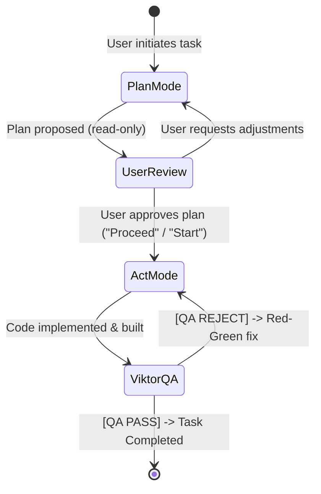

# 🛡️ Plan Mode vs. Act Mode & Worktree Isolation

Inspired by **Cline / Roo Code** and **Claude Code `--worktree`**, this protocol enforces strict execution discipline and physical isolation across multi-agent tasks.

---

## 🎯 1. The Two-Phase Execution Model

### Phase 1: Plan & Audit Mode (Contour A — Read-Only Architecture)
* **Write Tools Locked:** Specialist plugin subagents (`agents/*.md`) operate as dedicated **Read-Only Auditors & Architects** in IDE subagent sessions. They inspect code, index symbols, verify risks/contracts, and return structured **Patch Blueprints** (`Path`, `StartLine..EndLine`, exact `Target -> Replacement`, expected verification command) to Lead.
* **Read-Only Fallback Protocol:** If a specialist receives an edit/build instruction while lacking `edit_file` / `write_file` / `run_command` in its runtime toolset, it MUST immediately return `BLOCKED (read-only session)` with a verified Patch Blueprint via `send_message` instead of retrying or spawning workaround scripts.
* **Preflight & Deduplication (`1 Role = Max 1 Auditor`):** Before invoking any auditor, Lead runs `manage_subagents(action="list")`. Existing idle specialists are reused via `send_message`, never duplicated.
* **Exit Criterion:** User sign-off on the plan and Patch Blueprints (e.g. *"План одобряю"* or *"Подтверждаю старт"*).

### Phase 2: Act & Write Mode (Contour B — Capability-Routed Execution)
* **Small Surgical Changes (1–3 files / single subsystem):** Lead applies atomic edits directly via `edit_file` / `write_file` without spawning write subagents.
* **Parallel Feature Delivery (4+ files / independent subsystems):**
  - Lead uses either `define_subagent(EnableWriteTools: true)` (scoped with the domain instructions) or a `TypeName="self"` worker pool.
  - **NEVER re-dispatch `[ACT MODE]` file-editing orders to a Read-Only `agents/*.md` auditor session.**
  - **Reuse Pool First:** Check `manage_subagents(action="list")` and route follow-up waves to existing `idle` write workers via `send_message` before spawning new instances.
  - **Structured Mission Brief:** Every write worker receives (1) Goal, (2) Disjoint Owned Files/Directories, (3) Locked Contracts & Fleet Rules, (4) Done Criterion & Return Format, plus a strict prohibition against spawning nested subagents.

---

## 🌳 2. Isolation, Bounded Waves, Single Build Gate & Subagent GC
Synthesized from `obra/superpowers` (`subagent-driven-development`, `dispatching-parallel-agents`) and `sickn33/agentic-awesome-skills` (`subagent-orchestrator`):
1. **Bounded Waves (Max 3–5 Concurrent Workers):** Dispatch parallel work in waves of at most **3–5 active subagents** (narrow to 2–3 under quota pressure).
2. **Worktree vs. Disjoint Ownership Fallback:**
   - When `.git` / supported VCS is verified, `Workspace: "branch"` provides isolated worktrees.
   - If the workspace has no Git repo (`VCS type Unknown`), NEVER loop-retry `Workspace: "branch"`. Either initialize Git / use repo root if appropriate, or immediately fall back to `Workspace: "inherit"` with strict **Disjoint Write Ownership** (zero overlapping files between workers).
3. **Single Build / Test Gate:** Parallel write workers operating on a shared tree only edit their owned files and MUST NOT run competing full builds/tests (`bin`/`obj` file locks, flaky port collisions). Lead runs the authoritative build, typecheck, and test suite once the wave completes.
4. **Post-Restart Reconciliation & Mandatory GC (`manage_subagents(action="kill")`):**
   - After any restart/resume, inspect `manage_subagents(action="list")` plus disk state first and only resume truly incomplete tasks.
   - Once a wave finishes (or after `[COMPLIANCE PASS]` + `[QA PASS]`), clean up finished clones and redundant duplicates with `manage_subagents(action="kill", ConversationIds=[...])` (or `kill_all` at task close).

### 🚩 Anti-Pattern Red Flags (Stop Immediately If Observed)
| Red Flag | Correct Swiss-Watch Action |
| :--- | :--- |
| Spawning 2nd auditor of same specialist role | Call `manage_subagents(action="list")` and `send_message` to existing instance |
| Sending `[ACT MODE]` edits to read-only `agents/*.md` | Route edits to Lead (1–3 files) or `self` / `EnableWriteTools: true` pool |
| Launching >5 concurrent subagents in one wave | Split into bounded waves (3–5) and reuse `idle` workers |
| Retrying failed `Workspace: "branch"` on non-Git folder | Switch immediately to Disjoint Ownership under `Workspace: "inherit"` |
| Leaving 20+ dead/finished workers in panel | Call `manage_subagents(action="kill")` after each phase / completion |
