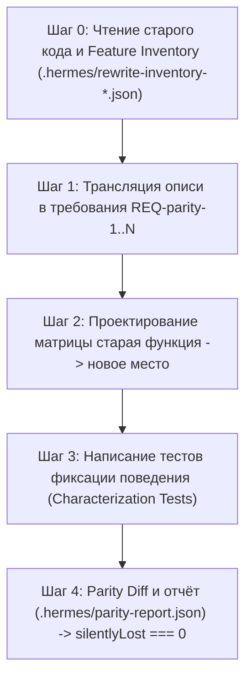

# 🔄 Протокол паритета при переписывании компонентов (Rewrite Parity Protocol)

Стандарт защиты от скрытой потери функциональности при полной переработке, рефакторинге или воссоздании компонентов с нуля в Hermes Fleet v4.0.0.
**Владелец методологии:** Сергей (`@sergey`).

---

## 🛑 Фундаментальная проблема: «Переписали с нуля — потеряли функции»

При глубокой модернизации или полной замене компонента (UI-окон, сервисов, контроллеров, драйверов сокетов) инженеры склонны концентрироваться на чистоте новой архитектуры, упуская десятки мелких, но критически важных для пользователя возможностей старой реализации:
* Настройки и значения по умолчанию в реестре или файлах конфигурации.
* Обработчики граничных событий (изменение размера, потеря фокуса, горячие клавиши).
* Специальные правила валидации полей ввода и условия `Enabled` / `Disabled`.
* Подсказки (tooltips), контекстные меню и вспомогательные вкладки.

> [!CAUTION]
> **Инвариант Hermes Fleet:** Пользователь никогда не должен выступать в роли тестировщика, выискивающего потерянные функции старого окна! Любая несанкционированная потеря поведения является скрытой регрессией и карается автоматическим вердиктом `🔴 [QA REJECT]`.

---

## 🪜 5-Шаговый процесс переписывания (Rewrite Parity Workflow)



### Шаг 0: Сплошная опись поведения (Feature Inventory)
**Выполняется ДО написания единой строки нового дизайна или кода.**
Агент обязан прочитать старый компонент целиком (`read_file` целевыми окнами) и составить исчерпывающую опись ВСЕГО наблюдаемого поведения из исходного кода.

Опись опирается строго на **grounded truth** (файл:строка кода первоисточника). Запрещено полагаться на память, предположения или краткие слова пользователя.

Категории обязательной описи:
1. **Настройки и параметры:** каждое поле, свойство, ключ реестра/конфига, значение по умолчанию.
2. **Элементы управления и свойства UI:** кнопки, чекбоксы, списки, шрифты, цвета, выравнивание.
3. **Обработчики событий:** клики, двойные клики, смена выделения, таймеры, перерисовка, закрытие.
4. **Валидация и ограничения:** диапазоны чисел, regex, обработка пустых строк, блокировка ввода.
5. **Горячие клавиши и навигация:** `Enter`, `Esc`, `Tab`-порядок, акселераторы (`&Save`), шорткаты (`Ctrl+S`).
6. **Контекстные меню и тултипы:** всплывающие подсказки, контекстные меню по правой кнопке мыши.
7. **Условная логика доступности:** при каких условиях элементы становятся `Enabled`/`Disabled`/`Visible`.
8. **Привязка данных и форматы:** маппинг в DTO, форматирование чисел, дат и единиц измерения.

Опись сохраняется в файле:
`.hermes/rewrite-inventory-<component>.json`

```json
{
  "component": "SettingsDialog",
  "sourceFiles": ["Legacy/SettingsDialog.cs", "Legacy/SettingsDialog.Designer.cs"],
  "totalFeatures": 18,
  "inventory": [
    {
      "id": "INV-001",
      "category": "validation",
      "file": "Legacy/SettingsDialog.cs",
      "line": 142,
      "description": "Порт подключения ограничен диапазоном 1..65535, при ошибке поле подсвечивается красным",
      "behaviorInvariant": "Port >= 1 && Port <= 65535"
    },
    {
      "id": "INV-002",
      "category": "hotkey",
      "file": "Legacy/SettingsDialog.Designer.cs",
      "line": 88,
      "description": "Кнопка 'Сохранить' имеет горячую клавишу Alt+S (&Save) и привязана к AcceptButton",
      "behaviorInvariant": "AcceptButton == btnSave"
    }
  ]
}
```

---

### Шаг 1: Автоматический перевод в требования паритета (`REQ-parity-1..N`)
Каждый пункт Feature Inventory автоматически становится отдельным требованием `REQ-parity-k` в реестре задач. Частичное закрытие или игнорирование любого пункта запрещено.

---

### Шаг 2: Проектирование архитектуры и матрица переноса
Новая архитектура компонента обязана содержать явную матрицу переноса:
* `старая функция` ➔ `новое архитектурное место (компонент, хук, сервис, ViewModel)`.
Если функция переносится в другое место интерфейса (например, из отдельной вкладки в общее модальное окно), её доступность обязана быть очевидной для пользователя.

---

### Шаг 3: Тесты фиксации поведения (Characterization Tests)
Перед удалением или заменой старого компонента пишутся тесты (юнит-тесты, UI E2E тесты FlaUI/Playwright или контрактные тесты), фиксирующие текущее поведение системы.
Новый компонент обязан успешно проходить данные тесты, подтверждая сохранение функционального паритета.

---

### Шаг 4: Механическая сверка паритета (Parity Diff & Gate)
После реализации нового компонента формируется итоговый отчёт паритета:
`.hermes/parity-report.json`

```json
{
  "component": "SettingsDialog",
  "inventoryTotal": 18,
  "preserved": 17,
  "approvedRemoved": 1,
  "silentlyLost": 0,
  "items": [
    {
      "id": "REQ-parity-1",
      "status": "preserved",
      "newFile": "Modern/SettingsWindow.xaml.cs",
      "newLine": 95,
      "verification": "PortRangeValidatorTests.PassesValidPort"
    },
    {
      "id": "REQ-parity-2",
      "status": "approvedRemoved",
      "reason": "Устаревший COM-порт протокола заменён на единый сокет TCP по согласованию с пользователем",
      "userApproved": true
    }
  ]
}
```

#### Правила приёмки Parity Diff:
1. **`silentlyLost === 0`:** Значение обязано быть строго равно нулю. Наличие хотя бы одной молчаливо потерянной функции немедленно блокирует завершение работы (`blockStop`).
2. **Санкционированное удаление (`approvedRemoved`):** Любой пункт может быть помечен как удалённый **ТОЛЬКО** при наличии прямого согласия пользователя, полученного через инструмент `ask_question`. Удаление без согласия классифицируется как дефект и блокирует Stop-гейт.

---

## 👥 Роли и зоны ответственности в Hermes Fleet

| Специалист | Зона ответственности в Rewrite Parity |
| :--- | :--- |
| **Сергей (`@sergey`)** | Владелец протокола: курирует Feature Inventory, characterization-тесты и декомпозицию. |
| **Елена (`@elena`)** | Проверяет, что каждый старый контрол, горячая клавиша, подсказка и настройка доступны в новом UI. |
| **Критик (`@kritik`)** | Проверяет эргономику нового окна: ни одна функция не должна быть скрыта или потеряна ради «красоты». |
| **Виктор (`@viktor`)** | Проводит приёмку Parity Diff: сверяет отчёт `.hermes/parity-report.json` и выносит вердикт `[QA PASS]`. |
| **Механический гейт (`qa-gate.mjs`)** | Блокирует Stop при `silentlyLost > 0` или отсутствии отчёта при переписывании файлов. |
