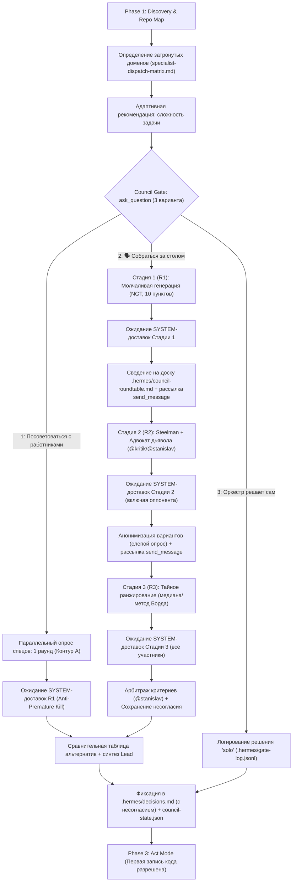

# 🏛️ Регламент Совета Специалистов (Specialist Council Protocol)

Данный документ определяет канонический протокол консультаций Lead Orchestrator с профильными специалистами флота Hermes ДО глубокого проектирования, декомпозиции и заморозки плана реализации (Phase 2 Master Workflow).

---

## 🎯 Назначение и Архитектурный Контекст

**Проблема одиночного проектирования (Solo Corner-Cutting):**
В сложных задачах Lead Orchestrator склонен вырабатывать план в одиночку, игнорируя отраслевые стандарты профильных доменов (БД, UI, сокеты, SAP, безопасность). Правило *«1–3 файла Lead правит сам»* относится **исключительно к физическому редактированию файлов в Контуре B**, но **не освобождает от экспертного проектирования в Контуре A**.

**Council Gate:**
Обязательный механический и процедурный гейт перед созданием плана и первой записью в кодовую базу (`clean-edits-guard`).



---

## 🪟 Универсальный Формат Окна Council Gate (`ask_question`)

После легкой разведки (Phase 1) и ДО формулирования финального плана Lead оценивает сложность задачи и вызывает `ask_question` со следующей структурой из **ровно трёх вариантов**:

* **Вопрос:** `Посоветоваться с советом специалистов до финального плана?`
* **Варианты ответов:**
  1. `(Recommended) Посоветоваться с работниками: @имена — независимые мнения + синтез (1 раунд; ~15k–40k токенов, ~1–3 мин)`
  2. `🗣️ Собраться за столом: @имена — живое обсуждение, 3 стадии (NGT/Дельфи: адвокат дьявола, тайный рейтинг; ~60k–150k токенов, ~5–9 мин)`
  3. `Нет, оркестр решает сам (экономия токенов; 0 доп. токенов, 0 мин)`

> [!NOTE]
> Частный случай варианта 1 («ключевой специалист»): если в задаче затрагивается ровно один профильный домен, вариант 1 формируется с одним именем: `(Recommended) Посоветоваться с работниками: @dmitry — независимое мнение + синтез (1 раунд; ~8k–20k токенов, ~1–2 мин)`.

---

## 🧭 Адаптивная Рекомендация и Ценник (Rule 13)

Пометка `(Recommended)` выставляется адаптивно в зависимости от сложности и масштаба задачи:
- **Тривиальное / точечное** (1 файл, опечатка, синтаксический фикс) ➔ рекомендуем вариант 3: `(Recommended) Нет, оркестр решает сам (экономия токенов)`.
- **Стандартное** (фичи в 1–2 модулях, изолированное расширение API/БД) ➔ рекомендуем вариант 1: `(Recommended) Посоветоваться с работниками...`.
- **Сложное / спорное / архитектурное** (межмодульные контракты, гонки, переработка ядра) ➔ рекомендуем вариант 2: `(Recommended) 🗣️ Собраться за столом...`.

**Ценник (Token & Time Budgeting):**
Оценка затрат токенов и времени указывается в окне диалога диапазоном по Правилу 13 (Data Honesty), без фиктивных точных чисел (~60k–150k токенов, ~5–9 мин для круглого стола из 3 стадий).

**Каскад моделей по стадиям (Model Cascade — протокольная рекомендация):**
Для оптимизации стоимости без потери строгости критики и синтеза рекомендуется разделять тиры моделей между ролями и стадиями:
- **Стадия 1 (R1 — первичная разведка и независимая генерация идей):** экономичный/быстрый тир (`Model: 'flash'` или `'flash_lite'` для рядовых скаутов) в рамках выбранного пользователем бюджетного тира.
- **Стадия 2 (R2 — адвокат дьявола `@kritik` / `@stanislav`) и Стадия 3 (R3 — слепое ранжирование, арбитраж критериев и финальный синтез Lead):** строгий/флагманский тир (`Model: 'pro'` или `'inherit'` при флагманской хост-модели).

> [!NOTE]
> **Ограничение платформы (Rule 13 — честность реализации):** В Google Antigravity CLI/IDE модель субагента фиксируется в момент создания (`invoke_subagent` параметр `Model`) либо наследуется от ведущего (`inherit`); платформа не поддерживает аппаратное переключение модели уже запущенного субагента на лету между сообщениями `send_message`. Поэтому каскад моделей реализуется как **протокольная рекомендация для оркестратора** при старте ролей (например, запуск рядовых скаутов R1 на `flash`, а назначенного адвоката дьявола и арбитра — на `pro`/`inherit`), а не как механический перехватчик внутри `clean-edits-guard`.

---

## 🗣️ Механика Круглого Стола NGT/Дельфи (Roundtable, 3 стадии)

При выборе варианта 2 активируется протокол круглого стола из трёх стадий по методологии Nominal Group Technique (NGT) и метода Дельфи для исключения конформизма и группового мышления:

1. **Стадия 1 (R1 — «Молчаливая» независимая генерация / Nominal Generation):**
   - Участники ростера запускаются параллельно в Контуре A (`invoke_subagent`, read-only).
   - Эксперты работают изолированно, исключая эффект якорения (anchoring bias).
   - Каждый специалист формирует предложение по каноническому 10-пунктовому контракту.
   - **Защита «скрытого профиля» (Hidden Profile Protection):** каждый обязан раскрыть УНИКАЛЬНЫЙ факт своего домена, не лежащий на поверхности.
   - Lead дожидается SYSTEM-доставок от всех участников Стадии 1.
2. **Сведение на доску (`.hermes/council-roundtable.md`):**
   - Lead сводит **полные предложения** специалистов (не выжимки, без усечения аргументов) на доску `.hermes/council-roundtable.md`.
   - Добавляются прямые ссылки на код проекта (`file:///...#L...`).
   - Доска является рабочим prose-артефактом Контура A.
3. **Стадия 2 (R2 — Доска, Перекрёстная критика, Адвокат дьявола, Steelman):**
   - Lead рассылает уведомление ростеру через `send_message(Recipient: <subagentUuid>, Message: "Ознакомьтесь с доской .hermes/council-roundtable.md и дайте реакцию...")`.
   - **Принцип Steelman:** перед критикой чужой идеи специалист обязан сформулировать её сильнейшую версию.
   - **ОБЯЗАТЕЛЬНЫЙ Адвокат дьявола (Devil's Advocate):** в ростер стола обязательно включается профильный оппонент (`@kritik` или `@stanislav`), чья прямая обязанность — вскрыть фундаментальные слабые места, неявные допущения и сценарии отказа.
   - Lead ожидает SYSTEM-доставок Стадии 2 от всех участников, включая обязательную доставку от назначенного адвоката дьявола.
4. **Досрочное завершение стола (Early Stop via 2FA & Dissent Dominance):**
   - Если по итогам Стадии 2 все предложения согласованы и оппонент подтвердил сходимость, Lead вправе вызвать `ask_question`:
     * Вопрос: `Стол сошёлся: завершить без стадии ранжирования (R3)?`
     * Варианты: `1. (Recommended) Завершить сейчас (экономия токенов)` / `2. Провести R3 (полный протокол)`
   - **Механические условия 2FA:** гейт засчитывает ранний стоп ТОЛЬКО при совокупности трёх факторов:
     a) Валидированный ответ пользователя с выбором варианта 1;
     b) Полные доставки R1 и R2 от всех активных участников;
     c) В SYSTEM-доставке оппонента (`@kritik` или `@stanislav`) присутствует маркер `[CONVERGED]` или `[NO DISSENT]` без единого маркера `[DISSENT]`.
   - **Принцип доминирования несогласия (Dissent Dominance):** маркер `[DISSENT]` от адвоката дьявола категорически перекрывает любые маркеры сходимости и делает Стадию 3 строго обязательной (досрочный стоп блокируется).
5. **Исключение дополнительных участников (Agent Dropout / Pruning):**
   - Lead вправе исключить из последующих стадий (R2 или R3) ТОЛЬКО дополнительных участников, не названных в выбранном пользователем варианте (`extra = dispatchedTypes \ expectedNames`).
   - Категорически запрещено исключать: названных специалистов (`expectedNames`), назначенного адвоката дьявола (`@kritik` / `@stanislav`), либо снижать число активных участников ниже обязательного кворума (`requiredCount`).
   - Исключённые участники фиксируются в `council-state.json` (`prunedUuids`).
6. **Стадия 3 (R3 — Тайное слепое ранжирование, Агрегация и Сохранение несогласия):**
   - Lead анонимизирует варианты (Вариант A, Вариант B...) **без указания имён авторов** (blind evaluation) для исключения статусного давления (authority bias).
   - Lead рассылает опросник через `send_message` каждому участнику ростера.
   - Участники независимо ранжируют варианты (баллы / приоритеты) и отправляют тайные оценки.
   - Lead агрегирует результаты объективным математическим методом (медиана / метод Борда).
   - **Арбитр критериев (@stanislav):** проверяет честность и неизменность критериев оценки (защита от metric-shopping и подгонки метрик под желаемый результат).
   - **Сохранение несогласия (Dissent Preservation):** консенсус НЕ навязывается силой. Голос одинокого несогласного эксперта защищён. Несогласие и отклонённые варианты с полным обоснованием и авторством заносятся в архитектурный журнал `.hermes/decisions.md`.
7. **Разнообразие УГЛОВ, а не голов (Diversity Prediction Theorem):**
   - Состав стола подбирается по разнице перспектив (архитектура, UI, БД, безопасность), а не простому числу соглашающихся агентов.
8. **Механический замок `clean-edits-guard`:**
   - При `mode: "roundtable"` гейт механически требует прохождения либо всех 3 стадий, либо 2 стадий с валидированным 2FA ранним стопом.
   - 2 стадии без санкции пользователя или при наличии несогласия блокируются отказом `deny`.

---

## 📜 Канонический Контракт Предложений и Дехаллюцинация

Для исключения галлюцинаций и формализма участники совета руководствуются правилом: **сначала уточняющие вопросы по коду, затем утверждения**.

Каждое предложение участника оформляется по единому 10-пунктовому контракту:
1. **Идея (Core Idea):** суть архитектурного решения или паттерна.
2. **Обоснование (Rationale):** почему решение подходит для текущей кодовой базы.
3. **Плюсы (Pros):** конкретные технические преимущества.
4. **Риски / Краевые случаи (Risks & Edge Cases):** потенциальные сбои, утечки, гонки.
5. **УНИКАЛЬНЫЙ факт (Unique Domain Fact):** отраслевая или платформенная деталь, неизвестная другим доменам.
6. **План проверки (Verification Plan):** точные тесты или шаги воспроизведения.
7. **ПРЕМОРТЕМ «если провалится — почему» (Pre-Mortem):** главный сценарий отказа в проде.
8. **Стоимость (Cost / Complexity):** оценка сложности реализации (Low / Medium / High).
9. **Уверенность (Confidence):** уверенность эксперта (High / Medium / Low).
10. **Что изменит мнение (What Would Change Mind):** какие факты или тесты заставят пересмотреть вердикт.

---

## 👥 Роли и правила работы Совета (Анти-формализм)

1. **Строго Контур A (Read-Only):**
   Все участники совета работают исключительно в read-only режиме (`read_file`, `grep_search`). Инструменты записи (`write_file`, `edit_file`, мутирующие команды) для них заблокированы песочницей `clean-edits-guard`.
2. **Anti-Premature Kill:**
   После параллельного запуска специалистов (`invoke_subagent` / `send_message`) Lead обязан **немедленно завершить свой ход** и ожидать автоматических уведомлений хоста (`<SYSTEM_MESSAGE>`). Вызов `manage_subagents(kill)` или фальсификация ответов категорически запрещены.
3. **Требование альтернатив (Anti-Formalism Rule):**
   Каждый приглашённый специалист обязан выдать либо **≥1 конструктивную альтернативу** с плюсами, рисками и ограничениями, либо **мотивированное согласие** с предложенным Lead направлением с разбором краевых случаев своего домена.
4. **Обязательный синтез Lead:**
   Lead обязан по каждому поступившему предложению вынести явный вердикт: **Принято** или **Отклонено** с указанием конкретной технической причины.

---

## 📊 Формат Сравнительной Таблицы и Отчёта Синтеза

Результаты совета оформляются в чате в виде сравнительной таблицы:

| Альтернатива / Предложение | Автор | Плюсы | Риски / Ограничения | Вердикт Lead |
| :--- | :--- | :--- | :--- | :--- |
| Использовать System.Threading.Channels | @dmitry | Нулевая блокировка UI, backpressure | Требуется .NET Core 3.0+ | 🟢 Принято: стек проекта позволяет |
| Вынести статус в статус-бар окна | @elena | Оператор сразу видит состояние | Нужен ресайз статус-бара | 🟢 Принято: включено в задачу UI |
| Синхронная блокировка с тайм-аутом | @alexey | Простота реализации | Риск зависания UI при обрыве | 🔴 Отклонено: нарушает плавность GUI |

---

## 💾 Фиксация решений (`.hermes/decisions.md` и `.hermes/council-state.json`)

После подведения итогов совета Lead фиксирует результаты в артефактах сессии:

1. **`.hermes/decisions.md` (Архитектурный журнал):**
   ```markdown
   # Решение Совета Специалистов: [Название задачи]
   - Дата: YYYY-MM-DDTHH:mm:ssZ
   - Режим: parallel | roundtable | solo
   - Раундов завершено: 1 | 3 | 0
   - Состав стола/совета: @dmitry, @elena, @kritik (адвокат дьявола), @stanislav (арбитр)
   - Результат слепого ранжирования (медиана/Борда): Вариант A (1.2) > Вариант B (2.4)
   - Принятые идеи:
     * System.Threading.Channels (автор: @dmitry) — для изоляции сокетов от GUI.
     * Индикатор связи в статус-баре (автор: @elena) — 4 состояния UI.
   - Отклонённые варианты:
     * Синхронное ожидание (автор: @alexey) — риск блокировки UI-потока.
   - Сохранённое несогласие (Dissent Ledger / Особое мнение):
     * @kritik выразил несогласие с отказом от внешнего брокера сообщений при росте нагрузки >50k msg/s. Принято компромиссное решение: заложить абстрактный интерфейс IMessageBus.
   ```

2. **`.hermes/council-state.json` (Механическое состояние гейта):**
   ```json
   {
     "conversationId": "71e23bde-0b60-44d2-8dde-175d01630e77",
     "turnMarker": 3,
     "taskHash": "a1b2c3d4e5f60718",
     "task": "Build resilient WebSocket telemetry client",
     "mode": "roundtable",
     "decision": "roundtable",
     "requiredRounds": 3,
     "roundsCompleted": 3,
     "membersCount": 3,
     "status": "APPROVED",
     "timestamp": "2026-11-17T00:00:00.000Z"
   }
   ```
   > [!IMPORTANT]
   > Файл `.hermes/council-state.json` защищён от прямой записи и модификаций моделями через `clean-edits-guard` (`protectedVerdictPaths`). Запись производится исключительно хуком гейта после валидации транскрипта.

3. **`.hermes/progress-journal.jsonl` (Журнал прогресса и детекция застревания):**
   - Артефакт защищён от прямой записи и модификаций (`protectedVerdictPaths`).
   - Фиксирует машинные исходы тестов из `.hermes/test-summary.json`, `qa-verdict.json`, `security-verdict.json`: `{ "taskHash": "...", "outcome": "FAIL" | "PASS", "diffHash": "...", "ts": "..." }`. Текстовые заверения модели игнорируются (Правило 13).
   - **Stall Circuit Breaker (Детекция застревания):** при накоплении $\ge 3$ последовательных сбоев (`FAIL`) по одному `taskHash` дальнейшие правки кода блокируются гейтом (`deny`).
   - Разблокировка возможна только через:
     * Эскалацию в круглый стол через `ask_question` («Застряли: собрать стол?»);
     * Явное санкционированное решение пользователя продолжить самостоятельно («продолжить сам» / override);
     * Реальный `PASS` локальных тестов.
   - Эскалация фиксируется в `council-state.json` (`escalation: { taskHash, status, mode, timestamp }`).

4. **`.hermes/council-cost.jsonl` (Честная телеметрия стоимости / Rule 13):**
   - Фиксирует фактические затраты токенов: `{ "taskHash": "...", "mode": "roundtable" | "parallel", "tokens": number | null, "source": "transcript" | "unavailable", "timestamp": "..." }`.
   - Если хост или SDK не передаёт точные счётчики токенов, фиксируется `tokens: null` со статусом `source: "unavailable"` (Правило 13: нулевая фабрикация метрик).
   - В диалоговом окне ценник маркируется как «оценка (диапазон)», либо «измерено» при накоплении $\ge 3$ эмпирических замеров.

---

## ⚡ Исключения (когда окно Council Gate НЕ показывается)

В следующих сценариях Council Gate пропускается автоматически, а причина фиксируется в `.hermes/gate-log.jsonl`:

1. **Micro / Fast-Path:** тривиальные точечные правки (исправление опечатки, 1-строчный фикс, обновление комментария, синтаксический фикс по planning ladder).
2. **`/hermes fix-warnings`:** пакетное устранение предупреждений компилятора и линтера.
3. **Повторные итерации `/hermes loop`:** решение Council Gate принимается на всю задачу целиком, а не на каждую итерацию цикла сходимости.
4. **Прямые вызовы `@специалист`:** когда пользователь явно адресовал запрос конкретному агенту (`@dmitry`, `@elena` и т.д.).
5. **Режим конфигурации `off`:** когда в `.hermes/config.json` явно задано `"councilGate": "off"`.

---

## ⚙️ Режимы конфигурации (`.hermes/config.json`)

В файле `.hermes/config.json` поведение гейта регулируется свойством `councilGate`:

* `"ask"` (по умолчанию): интерактивный запрос через `ask_question` с 3 вариантами.
* `"auto"`: автоматический параллельный созыв совета без показа диалогового окна пользователю (доставки участников строго обязательны до первой записи).
* `"off"`: полное отключение механического замка Council Gate (разрешает немедленную запись).
