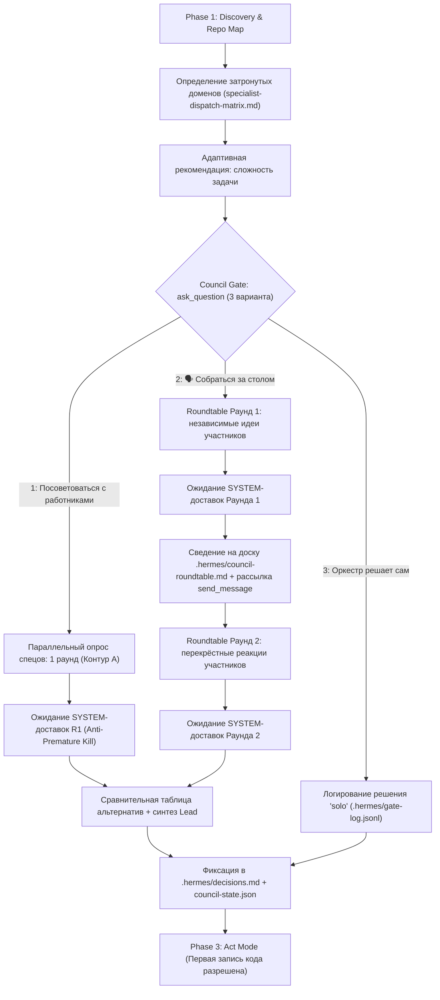

# 🏛️ Регламент Совета Специалистов (Specialist Council Protocol)

Данный документ определяет канонический протокол консультаций Lead Orchestrator с профильными специалистами флота Hermes ДО глубокого проектирования, декомпозиции и заморозки плана реализации (Phase 2 Master Workflow).

---

## 🎯 Назначение и Архитектурный Контекст

**Проблема одиночного проектирования (Solo Corner-Cutting):**
В сложных задачах Lead Orchestrator склонен вырабатывать план в одиночку, игнорируя отраслевые стандарты профильных доменов (БД, UI, сокеты, SAP, безопасность). Правило *«1–3 файла Lead правит сам»* относится **исключительно к физическому редактированию файлов в Контуре B**, но **не освобождает от экспертного проектирования в Контуре A**.

**Council Gate:**
Обязательный механический и процедурный гейт перед созданием плана и первой записью в кодовую базу (`clean-edits-guard`).



---

## 🪟 Универсальный Формат Окна Council Gate (`ask_question`)

После легкой разведки (Phase 1) и ДО формулирования финального плана Lead оценивает сложность задачи и вызывает `ask_question` со следующей структурой из **ровно трёх вариантов**:

* **Вопрос:** `Посоветоваться с советом специалистов до финального плана?`
* **Варианты ответов:**
  1. `(Recommended) Посоветоваться с работниками: @имена — независимые мнения + синтез (1 раунд; ~15k–40k токенов, ~1–3 мин)`
  2. `🗣️ Собраться за столом: @имена — живое обсуждение, 2 раунда (базовый roundtable; ~40k–100k токенов, ~3–6 мин)`
  3. `Нет, оркестр решает сам (экономия токенов; 0 доп. токенов, 0 мин)`

> [!NOTE]
> Частный случай варианта 1 («ключевой специалист»): если в задаче затрагивается ровно один профильный домен, вариант 1 формируется с одним именем: `(Recommended) Посоветоваться с работниками: @dmitry — независимое мнение + синтез (1 раунд; ~8k–20k токенов, ~1–2 мин)`.

---

## 🧭 Адаптивная Рекомендация и Ценник (Rule 13)

Пометка `(Recommended)` выставляется адаптивно в зависимости от сложности и масштаба задачи:
- **Тривиальное / точечное** (1 файл, опечатка, синтаксический фикс) ➔ рекомендуем вариант 3: `(Recommended) Нет, оркестр решает сам (экономия токенов)`.
- **Стандартное** (фичи в 1–2 модулях, изолированное расширение API/БД) ➔ рекомендуем вариант 1: `(Recommended) Посоветоваться с работниками...`.
- **Сложное / спорное / архитектурное** (межмодульные контракты, гонки, переработка ядра) ➔ рекомендуем вариант 2: `(Recommended) 🗣️ Собраться за столом...`.

**Ценник (Token & Time Budgeting):**
Оценка затрат токенов и времени указывается в окне диалога диапазоном по Правилу 13 (Data Honesty), без фиктивных точных чисел.

---

## 🗣️ Механика Базового «Стола» (Roundtable, 2 раунда)

При выборе варианта 2 активируется протокол круглого стола из двух раундов:

1. **Раунд 1 (Независимые предложения ростера):**
   - Lead запускает участников ростера (`invoke_subagent` в Контуре A, read-only).
   - Каждый специалист формирует независимое предложение по каноническому контракту.
   - Lead дожидается SYSTEM-доставок от всех участников Раунда 1.
2. **Сведение на доску (`.hermes/council-roundtable.md`):**
   - Lead сводит **полные предложения** специалистов (не выжимки, без усечения аргументов) на доску `.hermes/council-roundtable.md`.
   - Добавляются прямые ссылки на код проекта (`file:///...#L...`).
   - Доска является рабочим prose-артефактом (не защищена от записи Lead, в отличие от `council-state.json`).
3. **Раунд 2 (Перекрёстные реакции):**
   - Lead рассылает уведомление ростеру через `send_message(Recipient: <subagentUuid>, Message: "Ознакомьтесь с доской .hermes/council-roundtable.md и дайте реакцию на ≥1 чужое предложение...")`.
   - Каждый специалист читает доску в Контуре A, реагирует на чужие идеи, указывает скрытые риски или согласовывает синтез.
   - Lead ожидает SYSTEM-доставок Раунда 2 от всех участников.
4. **Механический замок `clean-edits-guard`:**
   - При `mode: "roundtable"` гейт механически проверяет наличие ≥2 полных раундов доставок от каждого участника ростера.
   - Попытка записи при незавершённом Раунде 1, без рассылки `send_message` или без доставок Раунда 2 блокируется отказом `deny`. Текстовая проза Lead «мы всё обсудили» отклоняется.

---

## 📜 Канонический Контракт Предложений и Дехаллюцинация

Для исключения галлюцинаций и формализма участники совета руководствуются правилом: **сначала уточняющие вопросы по коду, затем утверждения**.

Каждое предложение участника оформляется по единому 10-пунктовому контракту:
1. **Идея (Core Idea):** суть архитектурного решения или паттерна.
2. **Обоснование (Rationale):** почему решение подходит для текущей кодовой базы.
3. **Плюсы (Pros):** конкретные технические преимущества.
4. **Риски / Краевые случаи (Risks & Edge Cases):** потенциальные сбои, утечки, гонки.
5. **УНИКАЛЬНЫЙ факт (Unique Domain Fact):** отраслевая или платформенная деталь, неизвестная другим доменам.
6. **План проверки (Verification Plan):** точные тесты или шаги воспроизведения.
7. **ПРЕМОРТЕМ «если провалится — почему» (Pre-Mortem):** главный сценарий отказа в проде.
8. **Стоимость (Cost / Complexity):** оценка сложности реализации (Low / Medium / High).
9. **Уверенность (Confidence):** уверенность эксперта (High / Medium / Low).
10. **Что изменит мнение (What Would Change Mind):** какие факты или тесты заставят пересмотреть вердикт.

---

## 👥 Роли и правила работы Совета (Анти-формализм)

1. **Строго Контур A (Read-Only):**
   Все участники совета работают исключительно в read-only режиме (`read_file`, `grep_search`). Инструменты записи (`write_file`, `edit_file`, мутирующие команды) для них заблокированы песочницей `clean-edits-guard`.
2. **Anti-Premature Kill:**
   После параллельного запуска специалистов (`invoke_subagent` / `send_message`) Lead обязан **немедленно завершить свой ход** и ожидать автоматических уведомлений хоста (`<SYSTEM_MESSAGE>`). Вызов `manage_subagents(kill)` или фальсификация ответов категорически запрещены.
3. **Требование альтернатив (Anti-Formalism Rule):**
   Каждый приглашённый специалист обязан выдать либо **≥1 конструктивную альтернативу** с плюсами, рисками и ограничениями, либо **мотивированное согласие** с предложенным Lead направлением с разбором краевых случаев своего домена.
4. **Обязательный синтез Lead:**
   Lead обязан по каждому поступившему предложению вынести явный вердикт: **Принято** или **Отклонено** с указанием конкретной технической причины.

---

## 📊 Формат Сравнительной Таблицы и Отчёта Синтеза

Результаты совета оформляются в чате в виде сравнительной таблицы:

| Альтернатива / Предложение | Автор | Плюсы | Риски / Ограничения | Вердикт Lead |
| :--- | :--- | :--- | :--- | :--- |
| Использовать System.Threading.Channels | @dmitry | Нулевая блокировка UI, backpressure | Требуется .NET Core 3.0+ | 🟢 Принято: стек проекта позволяет |
| Вынести статус в статус-бар окна | @elena | Оператор сразу видит состояние | Нужен ресайз статус-бара | 🟢 Принято: включено в задачу UI |
| Синхронная блокировка с тайм-аутом | @alexey | Простота реализации | Риск зависания UI при обрыве | 🔴 Отклонено: нарушает плавность GUI |

---

## 💾 Фиксация решений (`.hermes/decisions.md` и `.hermes/council-state.json`)

После подведения итогов совета Lead фиксирует результаты в артефактах сессии:

1. **`.hermes/decisions.md` (Архитектурный журнал):**
   ```markdown
   # Решение Совета Специалистов: [Название задачи]
   - Дата: YYYY-MM-DDTHH:mm:ssZ
   - Режим: parallel | roundtable | solo
   - Раундов завершено: 1 | 2 | 0
   - Состав совета: @dmitry, @elena, @viktor
   - Принятые идеи:
     * System.Threading.Channels (автор: @dmitry) — для изоляции сокетов от GUI.
     * Индикатор связи в статус-баре (автор: @elena) — 4 состояния UI.
   - Отклонённые идеи:
     * Синхронное ожидание (автор: @alexey) — риск блокировки потока.
   ```

2. **`.hermes/council-state.json` (Механическое состояние гейта):**
   ```json
   {
     "conversationId": "71e23bde-0b60-44d2-8dde-175d01630e77",
     "turnMarker": 3,
     "taskHash": "a1b2c3d4e5f60718",
     "task": "Build resilient WebSocket telemetry client",
     "mode": "roundtable",
     "decision": "roundtable",
     "requiredRounds": 2,
     "roundsCompleted": 2,
     "membersCount": 3,
     "status": "APPROVED",
     "timestamp": "2026-11-17T00:00:00.000Z"
   }
   ```
   > [!IMPORTANT]
   > Файл `.hermes/council-state.json` защищён от прямой записи и модификаций моделями через `clean-edits-guard` (`protectedVerdictPaths`). Запись производится исключительно хуком гейта после валидации транскрипта.

---

## ⚡ Исключения (когда окно Council Gate НЕ показывается)

В следующих сценариях Council Gate пропускается автоматически, а причина фиксируется в `.hermes/gate-log.jsonl`:

1. **Micro / Fast-Path:** тривиальные точечные правки (исправление опечатки, 1-строчный фикс, обновление комментария, синтаксический фикс по planning ladder).
2. **`/hermes fix-warnings`:** пакетное устранение предупреждений компилятора и линтера.
3. **Повторные итерации `/hermes loop`:** решение Council Gate принимается на всю задачу целиком, а не на каждую итерацию цикла сходимости.
4. **Прямые вызовы `@специалист`:** когда пользователь явно адресовал запрос конкретному агенту (`@dmitry`, `@elena` и т.д.).
5. **Режим конфигурации `off`:** когда в `.hermes/config.json` явно задано `"councilGate": "off"`.

---

## ⚙️ Режимы конфигурации (`.hermes/config.json`)

В файле `.hermes/config.json` поведение гейта регулируется свойством `councilGate`:

* `"ask"` (по умолчанию): интерактивный запрос через `ask_question` с 3 вариантами.
* `"auto"`: автоматический параллельный созыв совета без показа диалогового окна пользователю (доставки участников строго обязательны до первой записи).
* `"off"`: полное отключение механического замка Council Gate (разрешает немедленную запись).
