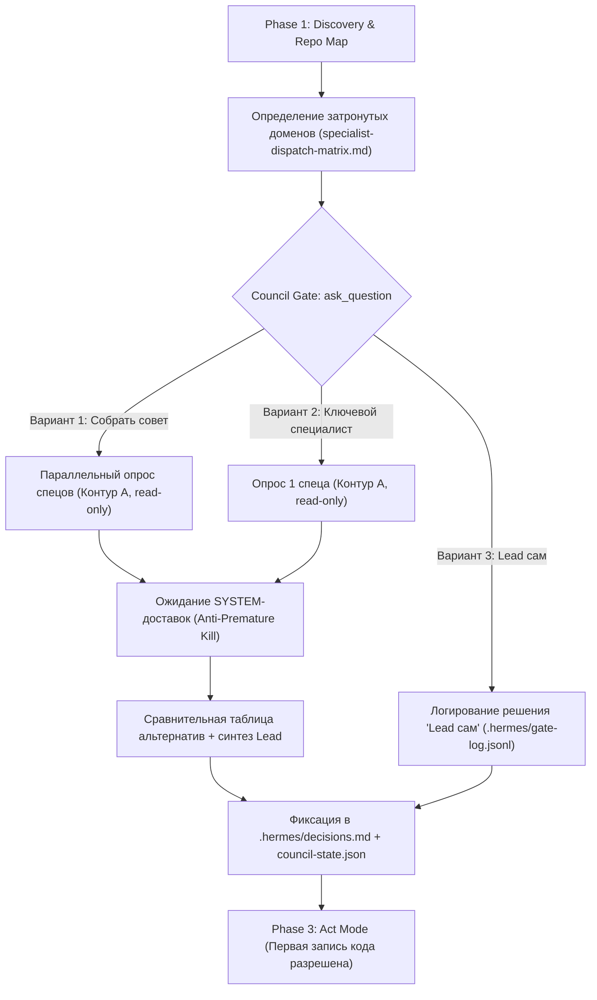

# 🏛️ Регламент Совета Специалистов (Specialist Council Protocol)

Данный документ определяет канонический протокол консультаций Lead Orchestrator с профильными специалистами флота Hermes ДО глубокого проектирования, декомпозиции и заморозки плана реализации (Phase 2 Master Workflow).

---

## 🎯 Назначение и Архитектурный Контекст

**Проблема одиночного проектирования (Solo Corner-Cutting):**
В сложных задачах Lead Orchestrator склонен вырабатывать план в одиночку, игнорируя отраслевые стандарты профильных доменов (БД, UI, сокеты, SAP, безопасность). Правило *«1–3 файла Lead правит сам»* относится **исключительно к физическому редактированию файлов в Контуре B**, но **не освобождает от экспертного проектирования в Контуре A**.

**Council Gate:**
Обязательный механический и процедурный гейт перед созданием плана и первой записью в кодовую базу (`clean-edits-guard`).



---

## 🪟 Формат окна Council Gate (`ask_question`)

После легкой разведки (Phase 1) и ДО формулирования финального плана Lead обязан вызвать `ask_question` со следующей структурой:

* **Вопрос:** `Посоветоваться с советом специалистов до финального плана?`
* **Варианты ответов:**
  1. `(Recommended) Собрать совет: <специалисты> — параллельные мнения + сравнительная таблица`
  2. `Только ключевой специалист: <главный специалист>`
  3. `Нет, Lead решает сам (экономия токенов)`

> [!IMPORTANT]
> Рекомендация совета формируется по [`specialist-dispatch-matrix.md`](specialist-dispatch-matrix.md) и включает **не более 3–4 профильных экспертов**, например:
> * Бэкенд/API: `@dmitry`, `@elena`, `@viktor`
> * Базы данных/миграции: `@denis`, `@dmitry`, `@viktor`
> * GUI/Окна/Стили: `@elena`, `@kritik`, `@viktor`
> * Сокеты/PLC/Оборудование: `@alexey`, `@igor`, `@elena`

---

## ⚡ Исключения (когда окно Council Gate НЕ показывается)

В следующих сценариях Council Gate пропускается автоматически, а причина фиксируется в `.hermes/gate-log.jsonl`:

1. **Micro / Fast-Path:** тривиальные точечные правки (исправление опечатки, 1-строчный фикс, обновление комментария, синтаксический фикс по planning ladder).
2. **`/hermes fix-warnings`:** пакетное устранение предупреждений компилятора и линтера.
3. **Повторные итерации `/hermes loop`:** решение Council Gate принимается на всю задачу целиком, а не на каждую итерацию цикла сходимости.
4. **Прямые вызовы `@специалист`:** когда пользователь явно адресовал запрос конкретному агенту (`@dmitry`, `@elena` и т.д.).
5. **Режим конфигурации `off`:** когда в `.hermes/config.json` явно задано `"councilGate": "off"`.

---

## 👥 Роли и правила работы Совета (Анти-формализм)

1. **Строго Контур A (Read-Only):**
   Все участники совета работают исключительно в read-only режиме (`read_file`, `grep_search`). Инструменты записи (`write_file`, `edit_file`, мутирующие команды) для них заблокированы песочницей `clean-edits-guard`.
2. **Anti-Premature Kill:**
   После параллельного запуска специалистов (`invoke_subagent` / `send_message`) Lead обязан **немедленно завершить свой ход** и ожидать автоматических уведомлений хоста (`<SYSTEM_MESSAGE>`). Вызов `manage_subagents(kill)` или фальсификация ответов категорически запрещены.
3. **Требование альтернатив (Anti-Formalism Rule):**
   Каждый приглашённый специалист обязан выдать:
   - Либо **≥1 конструктивную альтернативу** с плюсами, рисками и ограничениями.
   - Либо **мотивированное согласие** с предложенным Lead направлением с указанием специфических краевых случаев своего домена.
4. **Обязательный синтез Lead:**
   Lead обязан по каждому поступившему предложению вынести явный вердикт: **Принято** или **Отклонено** с указанием конкретной технической причины.

---

## 📊 Формат Сравнительной Таблицы и Отчёта Синтеза

Результаты совета оформляются в чате в виде сравнительной таблицы:

| Альтернатива / Предложение | Автор | Плюсы | Риски / Ограничения | Вердикт Lead |
| :--- | :--- | :--- | :--- | :--- |
| Использовать System.Threading.Channels | @dmitry | Нулевая блокировка UI, backpressure | Требуется .NET Core 3.0+ | 🟢 Принято: стек проекта позволяет |
| Вынести статус в статус-бар окна | @elena | Оператор сразу видит состояние | Нужен ресайз статус-бара | 🟢 Принято: включено в задачу UI |
| Синхронная блокировка с тайм-аутом | @alexey | Простота реализации | Риск зависания UI при обрыве | 🔴 Отклонено: нарушает плавность GUI |

---

## 💾 Фиксация решений (`.hermes/decisions.md` и `.hermes/council-state.json`)

После подведения итогов совета Lead фиксирует результаты в артефактах сессии:

1. **`.hermes/decisions.md` (Архитектурный журнал):**
   ```markdown
   # Решение Совета Специалистов: [Название задачи]
   - Дата: YYYY-MM-DDTHH:mm:ssZ
   - Состав совета: @dmitry, @elena, @viktor
   - Принятые идеи:
     * System.Threading.Channels (автор: @dmitry) — для изоляции сокетов от GUI.
     * Индикатор связи в статус-баре (автор: @elena) — 4 состояния UI.
   - Отклонённые идеи:
     * Синхронное ожидание (автор: @alexey) — риск блокировки потока.
   ```

2. **`.hermes/council-state.json` (Механическое состояние гейта):**
   ```json
   {
     "conversationId": "71e23bde-0b60-44d2-8dde-175d01630e77",
     "taskHash": "a1b2c3d4e5f60718",
     "task": "Build resilient WebSocket telemetry client",
     "decision": "council",
     "members": ["dmitry", "elena", "viktor"],
     "status": "APPROVED",
     "timestamp": "2026-11-17T00:00:00.000Z"
   }
   ```

---

## ⚙️ Режимы конфигурации (`.hermes/config.json`)

В файле `.hermes/config.json` поведение гейта регулируется свойством `councilGate`:

* `"ask"` (по умолчанию): интерактивный запрос через `ask_question`.
* `"auto"`: автоматический созыв совета без показа диалогового окна пользователю (доставки участников строго обязательны до первой записи).
* `"off"`: полное отключение механического замка Council Gate (разрешает немедленную запись).
