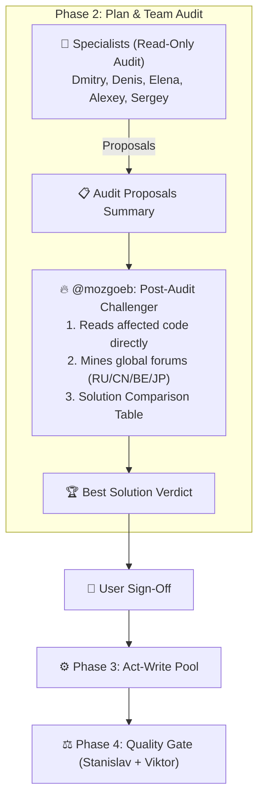

# 🔥 360° Product Critique & UX Scouting Reference (`@mozgoeb`)

Quick orchestration reference for **Lead** when engaging **Мозгоеб (`@mozgoeb`)**. Detailed standards in [`skills/product-ux-scouting/SKILL.md`](../../product-ux-scouting/SKILL.md) and [`global-forums-and-heuristics.md`](../../product-ux-scouting/references/global-forums-and-heuristics.md).

---

## 1. Two-Tier Architecture: Lead Lens vs Subagent @mozgoeb

### Tier 1: Built-in Lead Lens (Zero-Cost Local Quality Floor)
Lead applies Mozgoeb's quality floor on every task without subagent calls:
- **UI Ergonomics:** 4-state contract (`Idle/Loading/Success/Error`), click depth ≤ 2, no frozen UI.
- **Human Errors:** Plain-language cause + fix instructions instead of raw exceptions.
- **Engineering Invariants:** `Dry-Run` preview before destructive actions, auto-backup before migrations, startup `Doctor / Self-Test`, non-blocking patterns (`Channel<T>`, SQLite WAL).

### Tier 2: Subagent `@mozgoeb` (Explorer + Post-Audit Challenger)
Invoked for deep exploration or final solution gating before writing code:
1. **🧭 Independent 360° Explorer:** Inspects manifests, architecture, and UI via `read_file` to find killer features across the 6 Radars.
2. **🏆 Post-Audit Challenger:** At the end of Phase 2 (Plan & Audit), reviews specialist proposals, queries global forums (RU/CN/BE/EU/JP/Global via `search_web` + Read-Only `browser` `Model: "flash"`), and provides a Solution Comparison Table before Phase 3 Act.

---

## 2. The 6 Radars & 5-Point Vetting Gate

- **6 Radars of Benefit:**
  1. 🚀 *Killer Features* (Dry-Run, Undo, Ctrl+K, drafts, presets)
  2. 🛡️ *Self-Healing* (startup self-test, 1-click diagnostic bundle, auto-backup)
  3. ⚡ *Performance* (reactive streams, Channel<T>, zero-alloc Span<T>, WAL)
  4. 🤖 *Smart Automation* (anomaly detection, auto-discovery, AI/RAG hooks)
  5. 🧰 *Global OSS Radar* (battle-tested MIT/Apache libraries)
  6. 🎨 *Modern UI/UX* (Nielsen 0-4, 4-state async, vector SVGs, anti-flicker)
- **5-Point Vetting Matrix:** (1) Stack/TFM fit, (2) License safety (MIT/Apache), (3) Community proof, (4) Footprint/Rule 9, (5) ROI ➔ **`[ADOPT / TRIAL / HOLD]`**.

---

## 3. Team Audit & Execution Lifecycle

