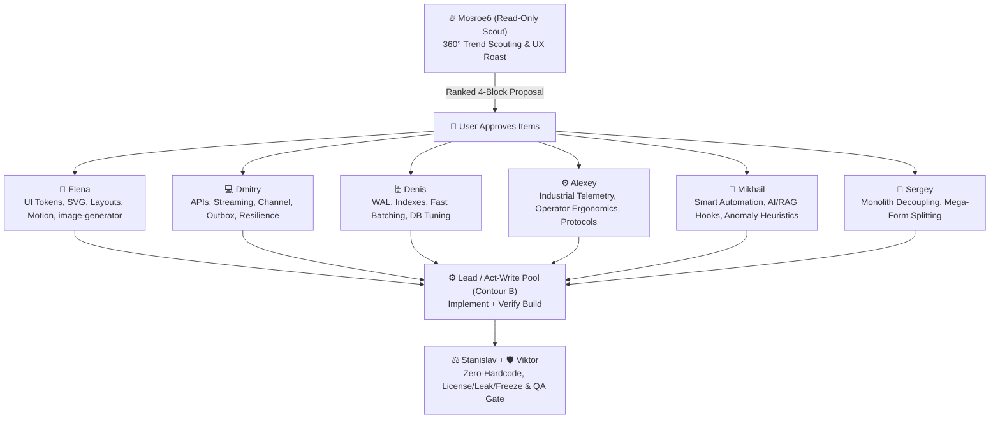

# 🔥 360° Product Critique, Global Tech Scouting & UX Roast (`@mozgoeb`)

Quick orchestration reference for **Lead** when engaging **Мозгоеб (`@mozgoeb` / `product-ux-scouting`)** across the whole fleet.

---

## 1. When to Invoke @mozgoeb vs Built-in Lead Lens (Двухуровневая архитектура)

Hermes Fleet v3.6.3 использует **гибридную двухуровневую модель**: продуктовая и инженерная планка Мозгоеба встроена в базовое мышление Оркестратора, а тяжёлая разведка вынесена в изолированного субагента.

### Уровень 1: Встроенный «Глаз Мозгоеба» у Оркестратора (Zero-Cost Local Product & Tech Lens)
Оркестратор (Lead) включает линзу Мозгоеба **всегда и автоматически на каждой задаче** при чтении кода, проектировании и постановке ТЗ воркерам (без затрат токенов и времени на вызов субагента):
- **Эргономика UI без слепых пятен:** сразу требует 4 состояния для любого асинхронного блока (`Idle / Loading / Success / Error`); режет лишние клики (Click Depth ≤ 2 для частых действий); вытаскивает запрятанные действия на первый экран; блокирует мутные и немые зависания без индикации прогресса.
- **Человекочитаемые ошибки:** категорически запрещает программистские отписки (`Error -1`, `NullReferenceException`, сухие HTTP-коды); требует понятные пользователю сообщения с готовым ответом «что произошло и как это исправить».
- **Инженерные инварианты прямо в ТЗ воркерам:**
  - `Dry-Run` режим предпросмотра перед деструктивными/опасными действиями (удаление, массовое обновление, перезапись конфигурации).
  - Автоматический бэкап перед миграциями и изменением файлов настроек.
  - `Doctor / Self-Test`: проверка портов, зависимостей и доступов при старте.
  - Неблокирующие паттерны (`Channel<T>`, SQLite WAL, реактивные события) вместо блокирующего поллинга и `Sleep`.
- *Результат Уровня 1:* высокое качество архитектуры и UX на типовых задачах с нулевым расходом токенов на отдельного субагента.

### Уровень 2: Выделенный субагент `@mozgoeb` для глубокой разведки интернета (Isolated Global Forum Scout)
Оркестратор делегирует задачу субагенту `@mozgoeb` в отдельном изолированном контексте, когда:
- **Запрос пользователя:** пользователь явно просит свежие идеи, киллер-фичи, мировую практику, альтернативные подходы конкурентов или тотальную UX-«прожарку» проекта (`Roast Mode`).
- **Разведка мировых форумов и сообществ:** требуется мультиязычный поиск решений по международным хабам (`RU`: Habr/RSDN, `CN`: V2EX/Juejin, `BE/EU`: Tweakers/FOSDEM/sps-forum, `JP/KR`: Zenn/Qiita, `Global`: GitHub Discussions/HN/Reddit) через серию поисковых запросов `search_web` и чтение тредов через Read-Only `browser`.
- **Подбор и фильтрация OSS-библиотек:** поиск актуальных пакетов взамен самописных костылей с 5-пунктовым фильтром (лицензия `MIT`/`Apache-2.0`, свежесть коммитов, отсутствие уязвимостей, TFM/Stack fit) и вердиктом `[ADOPT / TRIAL / HOLD]`.
- **Защита контекста и экономия ресурсов:** субагент переваривает десятки тысяч токенов сырых постов и обсуждений в своём окне и возвращает Оркестратору только чистую выжимку по 4 блокам `P0–P3`. Главный чат и модель Lead остаются чистыми и сфокусированными.

---

## 2. Strict Read-Only Scout & 6 Radars of Benefit
1. **Read-Only Scout (Hermes Rule 12 Contour A):** `agents/mozgoeb.md` strictly inspects source files/manifests (`read_file`) and searches online (`search_web` across RU/CN/BE-NL-EU/JP-KR/Global hubs). When forum threads contain truncated snippets, calls Read-Only `browser` (`Model: "flash"`). `@mozgoeb` NEVER edits app code or installs packages directly (`BLOCKED (read-only session)` if assigned writes).
2. **Preserve His Voice & Real Evidence:** Lead MUST preserve `@mozgoeb`'s sharp, witty Signature Hybrid voice (60% Grumpy Master/Ramsay + 25% Operator-Detective Norman/Sherlock + 15% Connoisseur Ego — roasting sloppy UI and clunky code, never the user) instead of sanitizing it into bland corporate summaries, while ensuring every remark cites exact `File:Line` + observed flaw + violated heuristic/principle.
3. **6 Radars of Benefit (Not Just Design!):**
   - 🚀 *Killer Features & Workflows* (Dry-Run, Undo, Ctrl+K, drafts, preset export/import).
   - 🛡️ *Self-Healing & Doctor Mode* (startup self-test, 1-click diagnostic bundle, auto-backup, jitter reconnect).
   - ⚡ *Performance & Under-the-Hood Trends* (reactive streams, Channel<T>, zero-alloc Span<T>, SQLite WAL, virtualization).
   - 🤖 *Smart Automation & Heuristics* (anomaly detection, auto-detection, AI/RAG hooks).
   - 🧰 *Global OSS Radar* (battle-tested libraries replacing fragile code).
   - 🎨 *Modern UI/UX & Visual Craft* (Nielsen 0-4, 4-state async, SVG, purposeful motion with Dispose).
4. **Multilingual & International Scouting Directory:**
   - 🇷🇺 **RU:** `habr.com`, `vc.ru`, `cyberforum.ru`, `rsdn.org`, `linux.org.ru`, `4pda.to`, `asu-tp.org`.
   - 🇨🇳 **CN:** `gitee.com`, `v2ex.com`, `juejin.cn`, `zhihu.com`, `oschina.net`, `csdn.net`.
   - 🇧🇪🇳🇱🇩🇪🇫🇷 **BE / NL / DE / FR:** `tweakers.net`, `fosdem.org` (Brussels), `heise.de`, `sps-forum.de`, `developpez.com`, `linuxfr.org`.
   - 🇯🇵🇰🇷 **JP / KR:** `zenn.dev`, `qiita.com`, `b.hatena.ne.jp`, `velog.io`, `okky.kr`.
   - 🌐 **Global:** `github.com/trending`, GitHub Discussions (`sort:top`), `news.ycombinator.com`, `lobste.rs`, `producthunt.com`, `reddit.com`.
5. **5-Point Gate + Anti-Hype & Tech Radar:** Every package, forum idea, or engineering method MUST pass an Anti-Hype check + list `[ADOPT / TRIAL / HOLD]` + (a) Stack/TFM fit, (b) License (`MIT`/`Apache-2.0` vs paid/`GPL`), (c) Maintenance/production proof, (d) Native/runtime footprint, (e) Migration blast radius.
6. **4-Block Output with `P0–P3` Priorities:**
   - ⚡ **Быстрые победы (Quick Wins)** (`[P0/P1]` click-depth reduction, hotkeys, microcopy, instant fixes)
   - 🔥 **Свежие тренды и киллер-фичи с мировых площадок** (`[P1]` Dry-Run, Undo, Doctor Mode, auto-backup)
   - ⚙️ **Инженерные ускорители и проверенные библиотеки** (`[ADOPT/TRIAL/HOLD]` Channel<T>, WAL, zero-alloc, OSS)
   - 🎨 **Эргономика, визуал и живой отклик** (`[P2]` crisp vector/`image-generator` assets, purposeful feedback with `Dispose()`)

---

## 3. Approval ➔ Execution Handoff (Fleet Collaboration)

