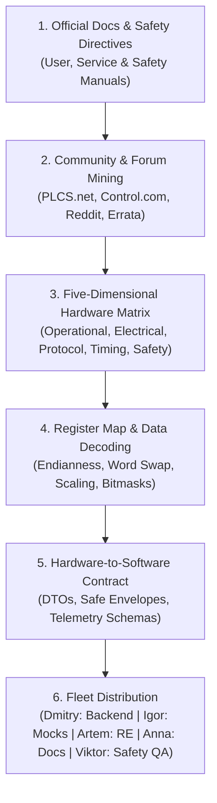

# Universal Industrial Equipment & Hardware Research Skill

This skill provides a comprehensive, vendor-neutral methodology for researching, analyzing, and integrating **any industrial equipment, machinery, controllers (PLCs), sensors, and automated production systems** from any manufacturer worldwide.

The Hermes Fleet operates as a team of **universal industrial systems developers**. We never restrict ourselves to specific machine brands or models; instead, we apply a universal engineering framework that guarantees **hardware safety, compliance with manufacturer instructions, and integration of real-world community field experience**.

---

## 🎯 1. Universal Equipment Research Workflow



---

## 🔍 2. Phase 1: Technical Documentation & Forum Mining

When researching any machine or controller, Alexey and the team gather official documentation across 5 primary sources:

### 1. Official Manufacturer Documentation (5 Document Types):
1. **User / Operator Manual (OM):**
   - High-level functional description, control panel screens, operational states, standard operating procedures, alarm and warning codes.
2. **Safety & Protective Directives Manual (SD):**
   - Emergency Stop (E-Stop) circuitry, dual-channel safety relays, safety light curtains, interlocks, maximum safe operating limits (speed, temperature, pressure, torque, travel limits).
3. **Service & Maintenance Manual (SM):**
   - Electrical wiring diagrams, terminal block pinouts, sensor locations, pneumatic/hydraulic schematics, calibration procedures, component part numbers.
4. **Communication & Interface Specification (CIS / Comms Manual):**
   - Supported physical buses (RS-232/422/485, RJ45 Ethernet, CAN, Optical), baud rates, parity, stop bits, protocol standards (Modbus, Profinet, EtherCAT, OPC UA, proprietary ASCII/Binary).
5. **Register Map & Memory Reference (Memory Map):**
   - Exact memory offsets, holding register addresses, coils, data types, read/write permissions, scaling factors, and engineering units.

### 2. Community Field Knowledge & Forum Mining (Real-World Experience):
Manuals describe the "ideal" world, but **industrial forums reveal the real-world truth**. Alexey proactively searches:
* **Target Communities:** `PLCS.net` (the premier industrial automation forum), `Control.com`, `Reddit r/PLC`, `CNCzone`, GitHub issues, and official vendor support communities (Siemens Industry Online Support, Omron, Schneider, Rockwell Automation, etc.).
* **Critical Intel Extracted from Forums:**
  - **Known Firmware Errata & Bugs:** Hidden issues where specific firmware versions drop TCP packets, corrupt holding registers, or lock up after 49.7 days of uptime.
  - **Physical Wiring Gotchas:** Practical advice on cable shielding, grounding loops, whether RS-485 termination resistors (120 Ohm) are strictly necessary, or if a null-modem pinout inversion is required.
  - **Timing & Buffer Traps:** Real-world experiences of how fast the PLC CPU can actually be polled before crashing communication buffers (often different from marketing claims).
  - **Operator Workarounds:** Field-tested tricks used by plant technicians to recover machinery from obscure lockups.

> [!TIP]
> **Search Pattern for Forum Mining:**
> - `"<Model_Number>" ("problem" OR "bug" OR "errata" OR "disconnect" OR "timeout" OR "registers") site:plcs.net`
> - `"<Model_Number>" ("wiring" OR "modbus" OR "socket" OR "firmware") site:control.com`
> - `"<Model_Number>" site:reddit.com/r/PLC`

---

## 🛡️ 3. Phase 2: Equipment Safety & Operational Protection Matrix

Safety is non-negotiable. Software interacting with industrial equipment must **never damage the machine or endanger factory personnel**.

### 1. Software Parameter Bounds Checking (Zero-Overdrive Policy):
Every command, speed setpoint, or target coordinate sent from software must pass strict bounds validation:
* **Velocity / Speed Limits:** Strictly capped below the manufacturer's maximum rated continuous speed (e.g. `clampedSpeed = Math.Clamp(requestedSpeed, 0, MaxRatedSpeed)`).
* **Thermal & Duty Cycle Boundaries:** If telemetry reports temperature approaching warning limits, throttle cycles or pause operations gracefully.
* **Mechanical Travel & Stroke Limits:** Software must enforce soft limits before physical limit switches or hard stops are triggered.

### 2. Emergency Stop (E-Stop) & Interlock Integrity:
* **Zero Override of Hardware Safety:** Software must **NEVER** bypass, ignore, or attempt to reset an active hardware E-Stop or door interlock remotely.
* **Immediate State Transition:** The moment an interlock or alarm bit is set, software must instantly transition the operational state to `Alarm` / `SafetyStop` and halt downstream dispatch.

### 3. Fail-Safe Principle on Disconnect:
* **Dead Man's Switch / Heartbeat Watchdog:** In the event of a lost socket or heartbeat timeout, the system must fail safe. It must NEVER leave output relays energized or assume the machine is still in its last known state.

---

## 📐 4. Phase 3: The Four-Dimensional Hardware Matrix

Every industrial machine is analyzed along four universal dimensions:

### Dimension 1: Operational States & Machine State Machine
- **Offline / Disconnected:** No electrical or network heartbeat.
- **Standby / Ready:** Control system energized, interlocks satisfied, waiting for run command.
- **Active / Running:** Machine actively executing cycles, generating output, reporting continuous telemetry.
- **Paused / Idle:** Temporary hold (operator pause, material wait, downstream blockage).
- **Warning / Degraded:** Operating within non-fatal warning thresholds (high temperature, low lubrication).
- **Alarm / Fault:** Hard stop triggered by sensor or software interlock (overload, jam, limit switch, emergency stop).
- **Maintenance / Setup:** Manual jogging, calibration, parameter adjustment mode.

### Dimension 2: Electrical & Physical I/O Specifications
- **Power Supply:** Voltage (24V DC, 110V/230V AC, 380V/400V 3-phase), current consumption, surge protection.
- **Digital Inputs (DI):** 24V PNP/NPN, optical isolation, push-buttons, limit switches, optical encoders, proximity sensors.
- **Digital Outputs (DO):** Relay contacts, solid-state switches, indicator towers, solenoid valves, contactor relays.
- **Analog I/O (AI/AO):** 4–20 mA current loops, 0–10 V voltage signals, thermocouples (PT100, Type K), load cells.
- **Safety Interlocks:** SIL / PL rating, dual-channel E-stop circuits, safety light curtains, guard switches.

### Dimension 3: Communication & Protocol Architecture
- **Physical Bus:** RS-232, RS-422, RS-485 (half/full duplex), 10/100/1000 Mbps Ethernet, CAN 2.0B, Fieldbus.
- **Standard Protocol Family:**
  - **Modbus (RTU / ASCII / TCP):** Function codes (0x01 Read Coils, 0x03 Read Holding Registers, 0x06 Write Single Register, 0x10 Write Multiple Registers).
  - **Industrial Ethernet:** Profinet (IO Controller/Device), EtherCAT (EtherCAT Slave Controller), Ethernet/IP (CIP messaging).
  - **Industrial IoT & SCADA:** OPC UA (Binary/XML TCP, security profiles, NodeIds), MQTT (Sparkplug B, JSON telemetry).
  - **Proprietary Socket Protocols:** Raw TCP/UDP streams, custom binary framing (Header, Length, Command, Payload, Checksum/CRC), or delimiter-separated ASCII streams (`STX ... ETX\r\n`).

### Dimension 4: Timing, Telemetry Rates & Network Budgets
- **Telemetry Polling Interval:** Safe polling rate derived from manufacturer manual + forum field findings (e.g. 200ms – 1000ms).
- **Heartbeat & Watchdog Deadline:** Maximum time before connection is declared dead (e.g. 5,000ms – 15,000ms).
- **Command Acknowledgment Timeout:** Expected latency between sending a control command and receiving the machine's ACK frame.

---

## 🔢 5. Phase 4: Register Map & Data Decoding Rules

| Parameter | Standard Variations & Pitfalls | Resolution Rule |
| :--- | :--- | :--- |
| **Addressing Base** | 0-based vs. 1-based (PLC offset 40001 vs. protocol register 0x0000) | Always document both PLC address and wire hex address |
| **Endianness** | Big-Endian (Motorola) vs. Little-Endian (Intel) | Check documentation for multi-byte integers (`AB CD` vs `CD AB`) |
| **Word Swapping (32-bit/64-bit)** | Big-Endian with word swap (`CD AB` vs `AB CD`) | Test with known non-zero values (e.g. total runtime meter) |
| **Data Types** | `INT16`, `UINT16`, `INT32`, `UINT32`, `IEEE 754 Float`, `ASCII String`, `Bitmask` | Use explicit strong typing in C# / backend models |
| **Scaling & Engineering Units** | Raw integer representing scaled decimals (e.g. `245` with scale `0.1` = `24.5 °C`) | Separate raw value from scaled engineering unit value in models |
| **Bitfields & Flags** | Single 16-bit word packing 16 individual boolean machine states | Decode using bitwise masks: `(word & 0x0001) != 0` |

---

## 🌉 6. Phase 5: Hardware-to-Software Contract Formulation

Alexey translates findings into structured contracts for the rest of the team:

### 1. Telemetry DTO for Dmitry (Backend):
```csharp
public sealed record MachineTelemetryDto(
    string MachineId,
    MachineState State,
    long CycleCount,
    double CurrentSpeed,
    double TemperatureCelsius,
    IReadOnlyList<MachineAlarmDto> ActiveAlarms,
    DateTimeOffset TimestampUtc
);
```

### 2. Mock Packet Specification for Igor (Simulator):
Provide the exact byte-level framing so Igor can build a zero-hardware mock server:
- Frame start delimiter (e.g. `0x02` or `0xAA 0x55`)
- Length field offset and endianness
- Command code / opcode map
- Payload byte offsets
- Checksum algorithm (CRC-16 Modbus, CRC-32, XOR sum, or simple addition)

### 3. Edge-Case Handshake for Artem (Reverse Engineering):
If the manufacturer uses a closed proprietary protocol or encrypted handshake:
- Provide captured network PCAP traces or serial dumps.
- Mark verified fields (e.g. machine serial number, known counter values) as reference anchors for Artem's REA analysis.

### 4. Technical Specification for Anna (Documentation):
- Formalize the equipment profile into `.hermes/docs/hardware/<machine-type>-spec.md` with interactive Mermaid sequence diagrams of communication flows.

---

## 🚫 7. Universal Engineering Rules (Anti-Patterns to Avoid)

1. **Zero Brand Lock-in:** Never write code that assumes all factory machines are from one specific manufacturer. Always abstract communication behind interfaces (`IMachineDriver`, `ITelemetryReceiver`).
2. **Never Ignore Manufacturer Limits:** Enforce parameter clamping in software. Never push hardware beyond its rated duty cycle or speed.
3. **Never Assume Ideal Networking:** Factory floors have high EMI, vibrating cables, and intermittent network switches. Always implement frame validation (CRC/Length), heartbeat monitoring, and bounded reconnection loops.
4. **No Unbounded Polling:** Respect the manufacturer's recommended scan rate. Polling too fast crashes PLC communication buffers.
5. **Fail-Safe Default:** An unparseable packet or lost heartbeat must immediately transition the software state to `Unknown` or `CommunicationWarning`, never silently reuse stale telemetry data.
