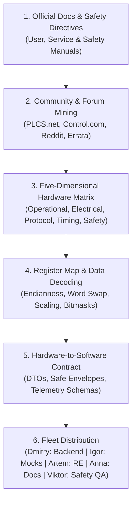

# Universal Industrial Equipment & Hardware Research Skill

This skill provides a vendor-neutral methodology for researching, analyzing, and integrating **industrial equipment, machinery, PLCs, sensors, and automated production systems** from any manufacturer worldwide.

The Hermes Fleet operates as universal industrial systems developers: we guarantee **hardware safety, compliance with manufacturer limits, and integration of real-world community field experience**.

---

## 🎯 1. Universal Equipment Research Workflow

---

## 🔍 2. Phase 1: Technical Documentation & Forum Mining

### 1. Official Documentation (5 Document Types):
1. **User / Operator Manual (OM):** States, operating workflows, alarms, control panels.
2. **Safety Directives (SD):** E-Stop circuits, dual-channel safety relays, light curtains, travel limits.
3. **Service & Maintenance (SM):** Pinouts, terminal blocks, wiring schematics, calibration.
4. **Communication Spec (CIS):** Physical bus (RS-485, RJ45 Ethernet, CAN), baud rates, Modbus/Profinet/EtherCAT/OPC UA framing.
5. **Register / Memory Map:** Addresses, data types, read/write permissions, scaling factors, units.

### 2. Community Field Knowledge & Forum Mining:
Search `PLCS.net`, `Control.com`, `Reddit r/PLC`, `CNCzone`, and vendor portals for:
- **Firmware Errata:** Known dropped frames, register corruption, or buffer lockups.
- **Wiring & Grounding Traps:** Cable shielding, termination resistors (120 Ohm), ground loops.
- **Timing & Buffer Limits:** True safe polling frequencies before PLC CPU crash.

---

## 🛡️ 3. Phase 2: Equipment Safety & Operational Protection Matrix

Safety is non-negotiable. Software interacting with industrial equipment must **never damage machines or endanger personnel**:
1. **Parameter Bounds (Zero-Overdrive):** Clamp speeds and coordinates (`clampedSpeed = Math.Clamp(speed, 0, MaxRatedSpeed)`).
2. **Zero Override of Hardware Safety:** Never bypass or reset hardware E-Stops or door interlocks remotely.
3. **Fail-Safe Disconnects:** Lost socket or heartbeat watchdog must instantly transition to `Alarm`/`SafeStop` (never leave relays energized).

---

## 📐 4. Phase 3 & 4: Hardware Matrix & Register Decoding

Every industrial machine is analyzed across four dimensions (Operational States, Electrical I/O, Protocol Architecture, Timing & Watchdogs) and register decoding rules (Endianness, Word Swapping, Scaling, Bitmasks).

👉 Full Four-Dimensional Matrix & Register Map Playbook: [`references/hardware-matrix-and-registers.md`](references/hardware-matrix-and-registers.md).

---

## 🌉 5. Hardware-to-Software Contracts

1. **Telemetry DTO for Dmitry (Backend):** Strongly typed models separating raw registers from scaled units.
2. **Mock Packet Spec for Igor (Simulator):** Exact framing (delimiters, opcodes, CRC-16) for zero-hardware socket mocks.
3. **Edge-Case Handshake for Artem (Reverse Engineering):** Wire dumps/PCAP for closed proprietary protocols.
4. **Technical Spec for Anna (Docs):** Interactive sequence diagrams in `.hermes/docs/hardware/<machine>-spec.md`.

---

## 🚫 6. Universal Anti-Patterns to Avoid

1. **Zero Brand Lock-in:** Abstract all hardware behind interfaces (`IMachineDriver`, `ITelemetryReceiver`).
2. **Never Ignore Limits:** Enforce soft travel and speed limits before hard stops trip.
3. **Never Assume Ideal Networking:** Implement CRC/length validation and jitter-reconnection loops.
4. **No Unbounded Polling:** Respect manufacturer recommended scan intervals.
