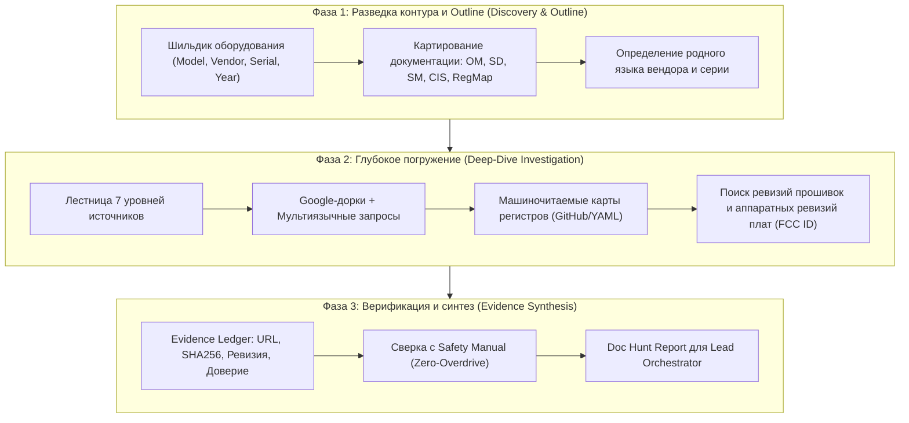

# 🔍 Руководство по поиску скрытой документации и мануалов (Manual Hunting Playbook)

Стандарт глубокого поиска технической документации, скрытых схем подключения, прошивок и карт регистров промышленного оборудования для Алексея (`@alexey`).

---

## 🧭 1. Двухфазная методология аппаратного ресёрча (Two-Phase Hardware Research)

Адаптировано из методологии **`Weizhena/Deep-Research-skills` (MIT)** для промышленного оборудования и закрытых протоколов:



1. **Фаза 1 (Outline & Taxonomy):** До любого глубокого поиска составляется профиль оборудования: точный артикул (order code), линейка/семейство, год выпуска, родной язык штаб-квартиры вендора (DE/JP/CN/US/RU) и целевой тип документа (Communication Spec vs Safety Manual).
2. **Фаза 2 (Deep-Dive):** Последовательный спуск по лестнице источников от официальных порталов к архивам, GitHub-репозиториям и FCC ID, отсекая шум минус-словами.
3. **Фаза 3 (Synthesis & Ledger):** Формирование машиночитаемого Evidence Ledger и отчёта «Doc Hunt Report» с явной классификацией доверия.

---

## 🪜 2. Лестница источников документации (Source Ladder)

Поиск ведётся строго сверху вниз. Переход на следующий уровень осуществляется только при отсутствии результатов на предыдущем.

### Уровень 1: Официальный портал вендора (Direct URL Patterns)
Большинство крупных вендоров используют предсказуемые URL-шаблоны или числовые идентификаторы документов:
* **Siemens Industry Online Support (SIOS):**
  - Шаблон: `https://support.industry.siemens.com/cs/ww/en/view/<entryID>`
  - Поиск по MLFB (артикулу): `6ES7...`, `6SL3...`. Прямая документация часто доступна через скачивание архива мануалов по ID.
* **Rockwell Automation / Allen-Bradley:**
  - Шаблон: `https://literature.rockwellautomation.com/idc/groups/literature/documents/<type>/<docnum>.pdf`
  - Пример типов: `um` (User Manual), `in` (Installation Instructions), `rm` (Reference Manual), `pm` (Programming Manual).
  - Официальные русскоязычные редакции: суффикс `-ru-p` (например, `1756-um001_-ru-p.pdf` вместо `-en-p.pdf`).
* **ABB Library:**
  - Шаблон: `https://library.abb.com/d/<DocumentID>` (ID формата `9AKK...` или `3BSE...`).
* **Mitsubishi Electric FA:**
  - Поиск по номеру мануала: код формата `SH-xxxxxxENG` (англ.) или `IB-xxxxxx` (серии iQ-R, FX5U, FR-A800).
* **Omron Industrial Automation:**
  - Порталы: `ia.omron.com` / `files.omron.eu` (каталоги мануалов часто содержат русские издания с кодами `Cat. No.`).

### Уровень 2: Снятое с производства оборудование (Discontinued & Legacy Archives)
* **Siemens SiePortal / Industry Mall:** Successor-lookup инструмент для нахождения современных преемников и архивных системных мануалов.
* **Rockwell Discontinued Product Bulletins:** Официальные бюллетени миграции с таблицами соответствия старых клемм и регистров.
* **Wayback Machine (`web.archive.org`):** Поиск старых разделов загрузки вендора по URL, указанным в старых каталогах или на шильдиках.

### Уровень 3: Промышленные агрегаторы мануалов
* `manualslib.com` — общая база, поиск по полному наименованию контроллера или частотника.
* `manualzz.com` — хорошая индексация сервисных мануалов и схем клеммников.
* `manuals.plus` — пользовательские инструкции и протоколы настройки.
* `industrialmanuals.com` — документация станков, ЧПУ (CNC), токарно-фрезерных комплексов и приводов.

### Уровень 4: Форумы инженеров АСУ ТП и файловые архивы
На форумах ищутся не только обсуждения, но в первую очередь **вложения, errata от наладчиков и дампы регистров**:
* **`plcs.net/downloads`:** Старейший архив, каталогизированный по брендам (Allen-Bradley, Omron, Modicon, GE Fanuc, Siemens). Содержит примеры проектов и неофициальные карты памяти.
* **`plctalk.net`:** Обсуждения багов прошивок и недокументированных опкодов.
* **`control.com`:** Архивы переписки инженеров полевого уровня по сокетам и RS-485.
* **`Reddit (r/PLC)`:** Поиск постов с ключевыми словами `errata`, `register list`, `undocumented`.
* **`CNCzone.com`:** Схемы станков, кинематика, протоколы энкодеров и оптических линеек.

### Уровень 5: Репозитории открытого кода (GitHub Machine-Readable Maps)
Перед тем как тратить часы на чтение 800-страничных PDF, проверяются готовые структурированные репозитории:
* **`proxusiiotplatform/modbus-register-maps`:** Готовые YAML/JSON профили регистров для сотен промышленных счётчиков, приводов и датчиков.
* **`jibrilsharafi/modbus-database`:** База данных Modbus-устройств.
* Поиск по GitHub: `filename:registers.yaml`, `filename:modbus.json`, `language:python "holding_registers" <модель>`.

### Уровень 6: Аппаратный реверс и скрытая начинка (FCC ID & Patents)
Когда вендор засекретил распиновку и чипсет:
* **FCC ID Database (`fccid.io`):** Поиск по FCC ID с шильдика радио- и Ethernet-устройств. Предоставляет **фотографии плат высокого разрешения (Internal Photos)**, маркировку микросхем трансиверов (RS-485, Ethernet PHY), антенные тракты и протоколы заводских испытаний.
* **Google Patents (`patents.google.com`):** Поиск патентов компании-вендора. Раскрывает алгоритмы модуляции, структуры пакетов и проприетарные методы синхронизации.

### Уровень 7: Региональные порталы и дистрибьюторы (RU-сегмент)
* **`owen.ru/manuals`:** Паспорта, руководства по программированию и карты регистров ОВЕН (ПЛК, МВ, ТРМ).
* **`reglab.ru/docs`:** Документация по ПЛК REGUL (Prosoft Systems).
* **`crevis.ru`:** Модули распределённого ввода-вывода Crevis/FnIO.
* **`siemens-pro.ru` / `kip-guide.ru`:** Неофициальные зеркала русскоязычных мануалов Siemens, Schneider Electric, Danfoss.

---

## 🎯 3. Каталог Google-дорков (Dork Catalog & Polyglot Search)

### Базовые поисковые шаблоны:
```text
"<модель>" filetype:pdf (manual | "register map" | "communication manual" | "user guide")
site:support.industry.siemens.com "<модель>" (manual | firmware)
site:literature.rockwellautomation.com "<bulletin>" filetype:pdf
intitle:"register map" ("Modbus" | "OPC UA" | "EtherNet/IP") "<модель>"
inurl:download "<модель>" filetype:pdf
inurl:manuals "<модель>" -jobs -ebay -aliexpress -реферат
```

### Мультиязычная матрица запросов (Search in Vendor Native Language):
Документация на родном языке вендора часто содержит на 30–50% больше технических деталей и полные схемы, отсутствующие в английских кратких брошюрах:

| Страна вендора | Вендоры | Ключевые термины для дорков |
| :--- | :--- | :--- |
| 🇩🇪 **Германия** | Siemens, Beckhoff, Phoenix Contact, SEW-Eurodrive | `Betriebsanleitung`, `Gerätehandbuch`, `Kommunikationshandbuch`, `Registerbelegung`, `Schaltplan` |
| 🇯🇵 **Япония** | Mitsubishi, Omron, Fanuc, Yaskawa, Keyence | `取扱説明書` (Manual), `通信仕様書` (Comm Spec), `レジスタマップ` (Register Map), `配線図` (Wiring) |
| 🇨🇳 **Китай** | Inovance, Delta, Leadshine, Chint | `用户手册` (User Manual), `通讯协议` (Comm Protocol), `寄存器地址` (Register Address) |
| 🇷🇺 **Россия** | ОВЕН, Прософт/REGUL, Элметро, Микрол | `Руководство по эксплуатации`, `Карта регистров`, `Схема подключения`, `Описание протокола` |

---

## 📋 4. Регламент Evidence Ledger и отчёт Лиду (Doc Hunt Report)

### Принцип верификации источников:
> [!IMPORTANT]
> **Никогда не брать пределы безопасности из случайных PDF!**  
> Параметры предельных нагрузок, скоростей, напряжений и E-Stop цепей сверяются строго с физическим шильдиком станка и официальным Safety Manual с уровнем доверия `official`. Данные с форумов и агрегаторов считаются `community` или `unknown` и требуют перепроверки.

### Формат Evidence Ledger (журнал улик документации):
Каждый найденный документ фиксируется в реестре:
```json
{
  "documentId": "DOC-001",
  "title": "SINAMICS G120 Modbus RTU Register Specification",
  "vendor": "Siemens AG",
  "edition": "Rev 04/2023",
  "firmwareCompatibility": "v4.7 SP13+",
  "sourceUrl": "https://support.industry.siemens.com/cs/ww/en/view/109781234",
  "sha256": "e3b0c44298fc1c149afbf4c8996fb92427ae41e4649b934ca495991b7852b855",
  "trustLevel": "official",
  "scope": ["holding_registers", "fault_codes", "control_word"]
}
```

### Формат отчёта Лиду («Doc Hunt Report»):
```text
=== 📑 DOC HUNT REPORT: [Модель оборудования] ===
Статус поиска: [FOUND / PARTIALLY FOUND / NOT FOUND]
1. Официальные источники (Trust: official):
   - Safety Manual: <URL> [SHA256: ...]
   - Communication / Register Spec: <URL>
2. Общественные карты регистров (Trust: community):
   - GitHub / YAML: <URL> (проверено по драйверу)
3. Выявленные аппаратные особенности и errata:
   - Ревизия прошивки: min v2.10
   - Ограничения шины: RS-485 2-wire, 19200 8-E-1, пауза между фреймами >= 3.5 char
4. Неразрешённые неопределённости:
   - Не найдены адреса аварийных регистров 0x3000-0x3010 (передано Артему на реверс)
=================================================
```

---

## ⚖️ 5. Юридическая и промышленная безопасность (Legal & Safety)

1. **Только публичные документы:** Поиск ограничен открытыми источниками. Запрещён взлом систем авторизации, обход платных пейволлов или скачивание данных из закрытых корпоративных хранилищ.
2. **Вежливый Rate-Limit и robots.txt:** Уважение к веб-ресурсам производителей. Никаких агрессивных многопоточных краулеров.
3. **Чистота репозитория (No Binary Bloat):** Запрещено коммитить тяжелые PDF-файлы (10–100 МБ) в Git-репозиторий. Документы фиксируются в виде ссылок, метаданных и контрольных сумм в Evidence Ledger. В репозиторий переносятся только лёгкие машиночитаемые DTO, JSON/YAML-схемы регистров и спецификации Markdown.
