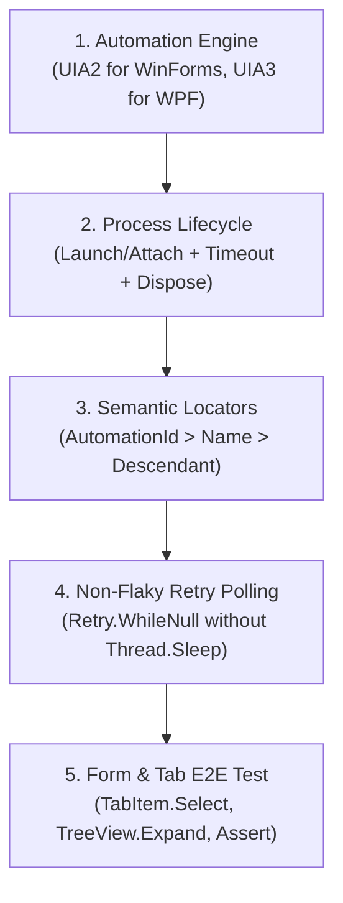

# 🤖 Automated Desktop UI Testing with FlaUI (.NET 10 / WinForms / WPF)

Production-grade desktop UI automation testing reference for **Viktor (`@viktor`)** to execute automated end-to-end (E2E) verification on Windows Forms and WPF applications without manual human clicking.

---

## 🏛️ The 5 FlaUI Automation Pillars



---

## 1. ⚙️ Automation Engine Selection: UIA2 vs. UIA3

* **`UIA2Automation` (Recommended for WinForms):** Windows Forms is built directly on native Win32 window handles (`HWND`). The managed UIA2 provider connects more reliably to Win32 controls (`TreeView`, `DataGridView`, `ComboBox`) than UIA3.
* **`UIA3Automation` (Recommended for WPF & WebView2):** Uses modern COM-based UI Automation 3.0, required for WPF data-binding templates and WebView2 Chromium roots.

```csharp
using FlaUI.Core;
using FlaUI.UIA2; // For WinForms
using FlaUI.UIA3; // For WPF / Hybrid

public static class AutomationFactory
{
    public static AutomationBase CreateForWinForms() => new UIA2Automation();
    public static AutomationBase CreateForWpf() => new UIA3Automation();
}
```

---

## 2. 🚀 Process Lifecycle & Teardown Protocol

Every automated test must guarantee application termination and COM cleanup, even if an assertion fails:

```csharp
using System;
using FlaUI.Core;
using FlaUI.Core.Application;
using FlaUI.Core.Automation;
using FlaUI.UIA2;
using NUnit.Framework;

[TestFixture]
public abstract class DesktopUiTestBase : IDisposable
{
    protected Application App { get; private set; } = null!;
    protected AutomationBase Automation { get; private set; } = null!;
    protected Window MainWindow { get; private set; } = null!;

    protected abstract string ExecutablePath { get; }

    [SetUp]
    public virtual void SetUp()
    {
        Automation = new UIA2Automation();
        // Launch with 10s window stabilization timeout
        App = Application.Launch(ExecutablePath);
        MainWindow = App.GetMainWindow(Automation, TimeSpan.FromSeconds(10));
        Assert.That(MainWindow, Is.Not.Null, "Main window did not appear within 10s.");
    }

    [TearDown]
    public virtual void TearDown()
    {
        Dispose();
    }

    public void Dispose()
    {
        try { MainWindow?.Close(); } catch { /* Ignore */ }
        try { App?.Close(); } catch { /* Ignore */ }
        App?.Dispose();
        Automation?.Dispose();
    }
}
```

---

## 3. 🎯 Element Locators Hierarchy (Ban Absolute Pixel Clicking)

Never use hardcoded `Mouse.Click(new Point(320, 140))`. Screen resolutions and DPI scaling vary:

1. **Top Priority: `AutomationId` (`cf.ByAutomationId("...")`):** Stable across languages and themes.
2. **Second Priority: `Name` (`cf.ByName("Save Changes")`):** Clean for standard buttons and tabs.
3. **Third Priority: `ControlType` (`cf.ByControlType(ControlType.TabItem)`):** For ordered collections.

```csharp
// Robust element discovery
var serverTab = MainWindow.FindFirstDescendant(cf => cf.ByAutomationId("tabServerSettings"))?.AsTabItem();
Assert.That(serverTab, Is.Not.Null, "Server Settings tab missing.");
serverTab.Select();
```

---

## 4. ⏳ Non-Flaky Asynchronous Polling (`Retry.WhileNull`)

**Strictly Ban `Thread.Sleep(2000)`!** Background threads (connecting to MSSQL or sockets) take variable time. Use FlaUI's built-in polling retry:

```csharp
using FlaUI.Core.Tools;

// Wait up to 5 seconds for status label to become "Connected", polling every 100ms
var statusLabel = Retry.WhileNull(
    () => MainWindow.FindFirstDescendant(cf => cf.ByAutomationId("lblStatus"))?.AsLabel(),
    TimeSpan.FromSeconds(5),
    TimeSpan.FromMilliseconds(100)
).Result;

Assert.That(statusLabel, Is.Not.Null, "Status label did not render in time.");
Assert.That(statusLabel.Text, Does.Contain("Connected"));
```

---

## 5. 📋 Full E2E Test Example: Dialog Automation (`ServerSettingsDialog`)

Automating a multi-tab dialog with TreeView, TextBoxes, and Save validation:

```csharp
[Test]
public void VerifyServerSettingsDialog_SavesPortAndSMBConfiguration()
{
    // 1. Open Settings Dialog from Main Menu
    var btnSettings = MainWindow.FindFirstDescendant(cf => cf.ByAutomationId("btnOpenSettings"))?.AsButton();
    Assert.That(btnSettings, Is.Not.Null);
    btnSettings.Click();

    // 2. Discover modal dialog window
    var settingsDialog = Retry.WhileNull(
        () => MainWindow.FindFirstDescendant(cf => cf.ByAutomationId("ServerSettingsDialog"))?.AsWindow(),
        TimeSpan.FromSeconds(3)
    ).Result;
    Assert.That(settingsDialog, Is.Not.Null, "Settings dialog did not open.");

    // 3. Switch to Loom Connection Tab
    var connectionTab = settingsDialog.FindFirstDescendant(cf => cf.ByName("Loom Connection"))?.AsTabItem();
    connectionTab?.Select();

    // 4. Update TCP Port
    var portTextBox = settingsDialog.FindFirstDescendant(cf => cf.ByAutomationId("txtLoomPort"))?.AsTextBox();
    Assert.That(portTextBox, Is.Not.Null);
    portTextBox.Text = "8085";

    // 5. Expand TreeView and select first device
    var treeView = settingsDialog.FindFirstDescendant(cf => cf.ByAutomationId("treeDevices"))?.AsTree();
    Assert.That(treeView, Is.Not.Null);
    var rootNode = treeView.Items[0];
    rootNode.Expand();
    rootNode.Items[0].Select();

    // 6. Click Save and confirm dialog closes
    var btnSave = settingsDialog.FindFirstDescendant(cf => cf.ByAutomationId("btnSave"))?.AsButton();
    btnSave?.Click();

    // 7. Verify modal dismissed
    bool isClosed = Retry.WhileFalse(
        () => settingsDialog.IsDisposed || !settingsDialog.IsAvailable,
        TimeSpan.FromSeconds(3)
    ).Result;
    Assert.That(isClosed, Is.True, "Dialog failed to close upon saving.");
}
```

---

## 📋 Viktor's FlaUI Verification Checklist
- [ ] **Engine Selection:** UIA2 configured for WinForms HWND testing.
- [ ] **Teardown Guarantee:** `TearDown` disposes `Window`, `Application`, and `AutomationBase`.
- [ ] **No Hardcoded Sleep:** All state transitions awaited via `Retry.WhileNull` / `Retry.WhileFalse`.
- [ ] **AutomationId Discipline:** Elements queried by semantic `AutomationId`, not fragile X/Y coordinates.
- [ ] **Modal Traversal:** Dialog windows explicitly detected and asserted to close on save.
